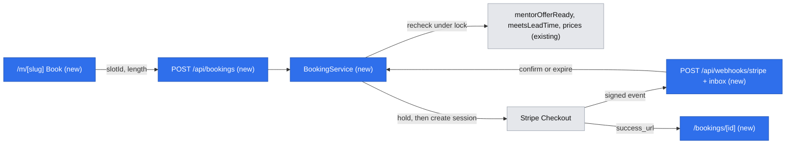
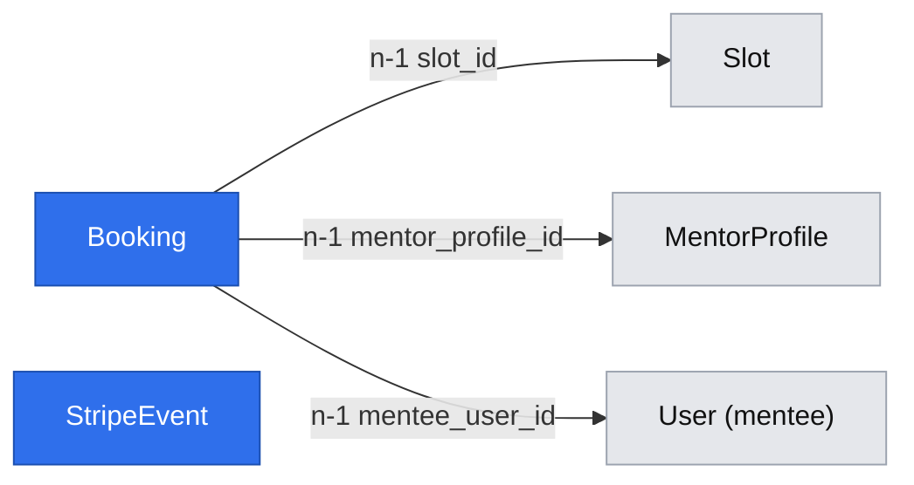

# A mentee books a slot at least two hours ahead and pays through Stripe Checkout

Status: approved — Q2 and Q7 confirmed by the owner on 2026-11-20
Issue: #29 (E03-S01) · Epic: #18 · Depends on: #23 (`.ai/specs/2026-10-21-mentor-page.md`), #24 (`.ai/specs/2026-10-21-mentor-prices.md`), #25 (`.ai/specs/2026-10-21-availability-slots.md`), #27 (`.ai/specs/2026-10-21-mentor-list.md`), #28 (`.ai/specs/2026-10-21-mentor-share-link-page.md`) · Shares the Stripe client contract with #26 (`.ai/specs/2026-10-21-stripe-connect-payouts.md`); owns the durable webhook inbox #26 phase 2 and #35 use · Source: `.ai/specs/product-brief.md` (R02, R06, R09, R10, R14, D09, D10, D11, Q04) · No course story spec exists for booking (lesson 05 ends at the bookable mentor)

## 📝 TLDR
Today a mentee can see a bookable mentor's prices and open times (#23–#28) but cannot book: nothing records a booking, takes payment or keeps two mentees from the same time. Proposed (future behaviour): a signed-in mentee picks an open time at least two hours ahead and a length (25 or 50 minutes), sees the mentor's server-held price, and pays through Stripe Checkout; the time is **held** for them while they pay, so a second mentee is refused before reaching Stripe and is never charged; Stripe's signed webhook, stored in a durable inbox before it is acted on, confirms the booking; an abandoned or failed payment releases the time. Booking is instant (D10): no mentor acceptance.

## 📝 Problem Statement
R06/R14 make Stripe Checkout the only way to pay, before the session; R09/D09 allow booking only two hours ahead and require the time from booking to start to be recorded for every booking (the brief's second measurement: median above 48 h in the first four weeks moves instant availability to 1.1); R02 lets the mentee choose 25 or 50 minutes at booking. #25 deliberately left occupancy, viable lengths, overlap prevention and booking-aware slot removal to this story, and #26/#35 wait for a durable webhook inbox. Without this story no session can happen, so the brief's first success measure (paid sessions in four weeks) cannot move.

## 📝 Proposed Solution
A `Booking` holds a slot from the moment the mentee commits (`POST /api/bookings`) until Stripe either completes or expires the Checkout Session. The hold is a row with status `pending_payment`, created in one transaction under the mentor profile's row lock, after rechecking everything the server owns: the mentor is `mentorOfferReady`, the slot is the mentor's, not removed, meets the two-hour lead (`meetsLeadTime`), and the chosen length does not overlap another active booking of the same mentor. A partial unique index on `slot_id` for active bookings is the backstop. Only then does the service create the Checkout Session (amount = the server-held price for that length, idempotency key = booking id) and return its URL. One deadline is computed before the transaction: the Checkout Session expires at it, and the hold at deadline + grace. A hold is never released on our clock alone: before a stale hold is released, Stripe is asked to expire the session (`expireCheckoutSession`), and a session Stripe reports `complete` is confirmed instead. So a payment cannot complete on a time already given to someone else, even when its webhook is late (R10: no automatic refunds).

`POST /api/webhooks/stripe` verifies the signature, inserts the event into `stripe_events` (idempotent by Stripe event id) and processes it in the same request: `checkout.session.completed` with `payment_status = paid` confirms the booking (records `confirmed_at` and the booking-to-start lead, R09); `checkout.session.expired` expires it. A processing failure leaves the stored event unprocessed and answers 500, so Stripe redelivers and the stored row makes redelivery idempotent.

**In scope:** `Booking` and `StripeEvent` entities and migration; `BookingService` (`start`, `confirmFromCheckout`, `expireFromCheckout`, `expireStaleHolds`, `getOwn`); occupancy and viable lengths (`bookableLengths`) on the public slot read; booking-aware slot removal (409); the Stripe client (#26's contract — whichever story lands first builds it) with `createCheckoutSession` and `expireCheckoutSession`; the webhook inbox and its handler registry; `POST /api/bookings`, `GET /api/bookings/[id]`, `POST /api/webhooks/stripe`; the booking controls on `/m/[slug]` (length choice, price, Book), sign-in redirect for visitors; `/bookings/[id]` (status page after Checkout); "Booked" state on `/mentor/slots`; confirmation emails to mentee and mentor through the existing `MailSender`; a Stripe stub for integration tests.
**Out of scope:** cancellation and refunds (#30, R10); the session itself and where it happens (#31, brief Q01); platform fee, transfers and payouts (#35; Connect onboarding #26); the mentee's list of bookings beyond `/bookings/[id]`; reminders; Stripe Tax and invoices; payment methods other than card (see Resolved assumptions Q2); any response-time promise (R09).

Alternatives considered:
- **Book only after payment (no hold).** Rejected: two mentees can both pay for one time; the loser must be refunded automatically, which R10 excludes and which AC4 forbids ("the other is not charged").
- **Lock the slot inside Stripe (one Checkout Session per slot).** Rejected: Stripe has no exclusive-slot concept; the hold must be ours.
- **Hold longer than the Checkout Session without a deadline.** Rejected: an abandoned tab would block a time indefinitely; the deadline is explicit and enforced by both Stripe (`expires_at`) and us.
- **Postgres exclusion constraint on `tstzrange` (btree_gist) for overlap.** Deferred: needs an extension and a raw-SQL migration; the profile row lock serializes every booking of one mentor (the codebase's established pattern, lessons 2026-10-26) and the unique slot index backstops the common case. Revisit if bookings move outside the lock.
- **Process webhooks asynchronously (queue/worker).** Rejected for 1.0: the project has no queue (core AGENTS: in-process events only); store-then-process in the request plus Stripe's own redelivery gives durability without a worker.
- **Stripe SDK.** Rejected: engineering standards §1 and #26 — a small form-encoded client over `fetchJson`.

## 📝 Architecture
- `packages/db/src/entities/bookings/booking.entity.ts`, `packages/db/src/entities/payments/stripe-event.entity.ts` — new; one migration (`up`/`down`).
- `packages/core/src/services/payments/stripe-client.ts` — #26's contract (singleton; `fetchJson`; bearer `STRIPE_SECRET_KEY`; pinned `Stripe-Version`; `Idempotency-Key`; base `STRIPE_API_URL`; classified outcomes `ok | retryable | idempotency_mismatch | rejected | misconfigured`). This story adds `createCheckoutSession(params, idempotencyKey)` and `expireCheckoutSession(id)`; #26 adds its Connect calls to the same client. Built behind a `CheckoutGateway` port with a Stripe adapter and an in-memory fake (unit tests never touch the network).
- `packages/core/src/services/payments/webhook-signature.ts` — pure `verifyStripeSignature(rawBody, header, secret, now)`: HMAC-SHA256 over `${t}.${body}`, constant-time compare against every `v1`, 5-minute tolerance; no SDK.
- `packages/core/src/services/payments/stripe-inbox.service.ts` — `receive(rawBody, signature)`: verify → insert `StripeEvent` if absent (`on conflict do nothing` semantics via the PK) → in one transaction lock the event row `FOR UPDATE`, re-check `processed_at`, and only if still null dispatch to the handler registered for `type` and set `processed_at` (two concurrent deliveries dispatch once); unknown types are stored and marked processed (ignored). Handlers are registered at container build (`checkout.session.completed`, `checkout.session.expired` here; #26 adds `account.updated`). A handler error rolls back its own writes, keeps `processed_at` null, records `attempts`/`last_error` (redacted), and the route answers 500 so Stripe retries.
- `packages/core/src/services/bookings/booking.service.ts` — scoped, `{ em, clock, events, env, mentorProfileService, slotService, platformSettingsService, checkoutGateway, mailSender, logger }`:
  - `start(userId, { slotId, length })` → compute `deadline = now + 31 min` once (Stripe's minimum is 30; the extra minute absorbs latency and skew). One transaction holding the slot's mentor profile row `FOR UPDATE`: load slot (+ profile, owner); refuse own slot; `mentorOfferReady.assert` at `now`; `meetsLeadTime`; viable-length check against active bookings of that mentor (a `pending_payment` hold counts only while `hold_expires_at > now`); insert `Booking(pending_payment)` with price snapshot, `hold_expires_at = deadline + 5 min`; commit. Then (outside the transaction) `createCheckoutSession` with `expires_at = deadline`; on `ok` store `checkout_session_id` and return `{ bookingId, checkoutUrl }`; on any failure mark the booking `failed` (releases the time) and answer 503. The unique slot index violation → 409 `SLOT_TAKEN`.
  - `confirmFromCheckout(session)` (inbox handler) → lock the booking by `client_reference_id` (the booking id — always set, unlike `checkout_session_id`, which may not be stored yet); `pending_payment` and `payment_status = paid` and amount/currency equal the snapshot → `confirmed`, `confirmed_at = now`, `checkout_session_id` filled if missing, `lead_minutes = floor((slot.starts_at − now) / 60 s)`; emit `bookings.booking.confirmed` after commit. Already `confirmed` → no-op (idempotent). Amount/currency mismatch, or `expired`/`failed` (prevented by the release rule below) → `payment_orphaned`, logged for the operator (R16), no automatic refund (R10).
  - Emails to mentee and mentor are sent after commit by a `bookings.booking.confirmed` subscriber, best effort: a mail failure is logged and never fails the webhook (no 500, no redelivery).
  - `expireFromCheckout(session)` → `pending_payment` → `expired`.
  - Releasing a stale hold (`pending_payment`, `hold_expires_at < now`) happens only inside `start`, for the conflicting hold on the requested slot: call `expireCheckoutSession`; if Stripe answers that the session is `complete`, run `confirmFromCheckout` with it and answer 409 `SLOT_TAKEN`; otherwise mark it `expired` and continue. Reads never write: the public read and `/mentor/slots` treat an expired-by-clock hold as free without changing its row.
  - `getOwn(userId, bookingId)` → the mentee's own booking or 404.
- `packages/core/src/services/availability/slot.service.ts` (#25) — `listPublicFor` gains `bookableLengths` per slot (lengths whose interval overlaps no active booking of that mentor; a slot with none is left out as taken); `remove` takes the same mentor profile row lock `FOR UPDATE` (today it runs without one) and, inside it, answers 409 `SLOT_BOOKED` when an active booking holds it; owner `listMine` items gain `booked: boolean`. `countBookable`/`bookableSummaryFor` count only slots with at least one bookable length.
- `packages/core/src/http/bookings.ts`, `packages/core/src/http/stripe-webhook.ts` — `apiHandler` handlers; the webhook uses `csrf: false` (third-party caller) and no body schema: the handler reads `await req.text()` itself before any JSON parsing, verifies the signature over those exact bytes, then `JSON.parse`s; it keeps `apiHandler`'s error mapping and logging (a small `rawBody` option on `apiHandler` if the current one parses first).
- `packages/app/src/app/api/bookings/route.ts` (`POST`), `api/bookings/[id]/route.ts` (`GET`), `api/webhooks/stripe/route.ts` (`POST`).
- `packages/ui/src/components/mentors/SlotBookingControls.tsx` (exported from `@devmentor/ui/mentors`, Tailwind, props only): per enabled slot, a length choice limited to `bookableLengths` with its price and **Book**, an error line, and the signed-out "Sign in to book" link. `packages/app/src/app/(marketing)/m/[slug]/` wires it: signed-in → `apiCall('/api/bookings')` then `window.location.assign(checkoutUrl)`; signed-out → `/sign-in?returnTo=/m/<slug>`.
- `packages/app/src/app/(mentee)/bookings/[id]/page.tsx` — signed-in owner only (`requirePageSession`); states below; refreshes itself while pending.
- `scripts/lib/stripe-stub.mjs` — local stub for integration (and local dev): `POST /v1/checkout/sessions` (records the session, returns `{ id, url, expires_at }`), a hosted page at `url` with **Pay** / **Cancel** buttons that send a signed `checkout.session.completed` / redirect to `cancel_url`, `POST /v1/checkout/sessions/:id/expire` sending a signed `checkout.session.expired`; webhook secret shared with the app through env. Wired like `github-stub.mjs` (`STRIPE_API_URL` override, `ALLOW_TEST_OVERRIDES=1`).

Takeaway: the hold is taken before Stripe is called and released only by Stripe's own completion or expiry (or our deadline), so occupancy is decided in one place.

## 📝 Data Model
`bookings` (new)
| Column | Type | Notes |
|---|---|---|
| id | uuid pk | also the Checkout idempotency key and `client_reference_id` |
| slot_id | uuid not null FK `slots` `on delete restrict` | immutable (#25: no relation on `Slot`) |
| mentor_profile_id | uuid not null FK `mentor_profiles` `on delete restrict` | denormalised for the per-mentor lock and overlap query |
| mentee_user_id | uuid not null FK `users` `on delete restrict` | from the session only |
| length_minutes | smallint not null | `CHECK (length_minutes IN (25, 50))` (R02) |
| price_cents | int not null | snapshot of the server-held price for the length; `CHECK > 0` |
| currency | char(3) not null | snapshot of the platform currency (PLN) |
| status | text not null | `pending_payment` \| `confirmed` \| `expired` \| `failed` \| `payment_orphaned`; `CHECK` on the set (#30 adds `cancelled`) |
| hold_expires_at | timestamptz not null | Checkout `expires_at` + grace |
| checkout_session_id | text null unique | set after the session is created |
| confirmed_at | timestamptz null | set on confirmation; `CHECK (status <> 'confirmed' OR confirmed_at IS NOT NULL)` |
| lead_minutes | int null | R09: minutes from confirmation to slot start, recorded once; `CHECK (status <> 'confirmed' OR lead_minutes IS NOT NULL)` |
| created_at, updated_at | timestamptz | |

Partial unique index `bookings_slot_active_uq` on `(slot_id)` where `status IN ('pending_payment','confirmed')`; index on `(mentor_profile_id, status)`.

`stripe_events` (new) — the durable inbox
| Column | Type | Notes |
|---|---|---|
| id | text pk | Stripe event id (`evt_…`): redelivery is a no-op |
| type | text not null | |
| payload | jsonb not null | the verified event; no card data exists in Checkout events |
| received_at | timestamptz not null | |
| processed_at | timestamptz null | null = to (re)process |
| attempts | int not null default 0 | |
| last_error | text null | redacted message, no payload |

`StripeEvent` has no foreign keys: handlers find their rows by ids in the payload (`checkout_session_id`, `client_reference_id`).

## 📝 API Contracts
| Route | Auth | Input | Answer |
|---|---|---|---|
| `POST /api/bookings` | signed in + CSRF | `bookingStartSchema` `{ slotId: uuid, length: '25' \| '50' }` | 200 `{ bookingId, checkoutUrl }`; 400 `VALIDATION_ERROR`; 404 unknown/removed/unpublished slot; 409 `SLOT_TAKEN` (held or booked, or the length overlaps); 409 `NOT_BOOKABLE` (mentor not offer-ready, or the slot is now within two hours); 403 own slot; 503 `PAYMENTS_UNAVAILABLE` (Stripe not configured or unreachable — nothing held) |
| `GET /api/bookings/[id]` | signed in, owner | — | `{ id, status, lengthMinutes, priceCents, currency, startsAt, mentor: { displayName, slug } }`; another user's id → 404 |
| `POST /api/webhooks/stripe` | Stripe signature, `csrf: false` | raw body + `Stripe-Signature` | 200 `{ received: true }` after commit; 400 bad/old signature (not stored); 500 when processing failed (stored, retried by Stripe) |

- All three: `Cache-Control: no-store`. New error codes are additive (`BACKWARD_COMPATIBILITY.md`: add codes, never repurpose).
- Public mentor read (#23/#28): each slot gains `bookableLengths: ('25'|'50')[]` (additive; key-equality test updated); taken slots are left out.
- Stripe Checkout Session parameters: `mode=payment`, one `line_items` entry with `price_data { currency: settings.currency, unit_amount: price_cents, product_data.name: "<25|50>-minute text session with <displayName>" }`, `client_reference_id = booking.id`, `metadata.booking_id`, `customer_email` = session email, `expires_at = deadline` (now + 31 min, just above Stripe's 30-minute minimum), `payment_method_types = ['card']`, `success_url = ${APP_URL}/bookings/{id}`, `cancel_url = ${APP_URL}/m/<slug>?checkout=cancelled`. Idempotency key = booking id.
- Env (optional, checked at the route; reused from #26 if it lands first): `STRIPE_SECRET_KEY`, `STRIPE_WEBHOOK_SECRET`, `STRIPE_API_URL` (default `https://api.stripe.com`, refused at boot without `ALLOW_TEST_OVERRIDES=1`). `.env.example` gets commented placeholders, never values; the integration runner passes stub values.

## 📝 UI/UX
- **`/m/[slug]`, offer-ready**: each enabled open time shows its bookable lengths as choices with the price ("25 min · PLN 150.00", "50 min · PLN 300.00"; a length that would overlap the next booking is not offered) and **Book**. Signed out → "Sign in to book" (returns to the page). After **Book**: the button shows "Opening payment…", then the browser goes to Stripe Checkout. An error (taken, not bookable, payments unavailable) shows under that time with the reason and the list refreshes. `?checkout=cancelled` → a line "Payment cancelled. The time is open again." No copy promises a response time or "guaranteed" (R09, design system Avoid).
- **`/bookings/[id]`** (signed-in owner; `(mentee)` shell): `pending_payment` → "Waiting for payment confirmation…" (re-reads every few seconds, max ~1 minute, then "This is taking longer than usual — refresh in a minute"); `confirmed` → "Booked: <length> with <mentor> on <LocalTime>. You paid <price>." plus "The mentor has been told by email." and nothing about response times; `expired`/`failed` → "This booking was not completed and you were not charged. The time may still be open." with a link back to the mentor page; `payment_orphaned` → "We received your payment but could not keep the time. We will contact you." (operator follows up by hand, R16).
- **`/mentor/slots`**: a booked slot shows "Booked" (no Remove); a held one shows "Held for payment" (no Remove until it expires).
- **Emails** (existing `MailSender`, `log` in dev): to the mentee and the mentor on confirmation — time in UTC plus "see DevMentor for your local time", length, mentor/mentee display name; no response-time wording.

## 📝 Edge Cases & Failure Scenarios
- Two mentees press **Book** for the same time at once → the profile row lock serializes them; the second sees `SLOT_TAKEN` before any Stripe call; only one Checkout Session exists (AC4).
- A 50-minute choice at 14:00 when another booking starts 14:30 → 50 is not offered and is refused server-side; 25 is offered.
- Mentee abandons Checkout → Stripe sends `checkout.session.expired` (or our deadline passes) → `expired`; the time is open again (AC3).
- Card declined → the session stays open until expiry; no booking is confirmed; the time is held until expiry (≤ 30 min + grace).
- Webhook arrives twice or out of order → the inbox stores it once; `confirmed` and `expired` transitions are idempotent and never go backwards.
- Webhook delivery is down for hours → the booking stays `pending_payment` past its hold; reads treat the time as free. When another mentee then presses **Book**, `start` asks Stripe to expire the old session first: a session Stripe reports `complete` is confirmed and the second mentee gets `SLOT_TAKEN`, so a paid time is never resold. The late webhook then finds `confirmed` → no-op.
- Card declined, mentee keeps retrying → Stripe keeps the session open until `expires_at`; the hold covers it.
- Amount or currency in the completed session differs from the snapshot → `payment_orphaned`, operator by hand.
- Confirmation email fails → logged; the booking stays confirmed and the webhook still answers 200.
- Stripe unreachable or misconfigured at **Book** → the hold is marked `failed` immediately, 503, nothing charged.
- The mentor removes the time while it is held → 409 `SLOT_BOOKED`; after expiry removal works again.
- The mentor stops being offer-ready (price out of bounds, unpublished) after a hold → the confirmation still honours the paid snapshot.
- The slot is under two hours away when **Book** is pressed → 409 `NOT_BOOKABLE`; the lead time is checked at **Book**, and `lead_minutes` is recorded at confirmation (≤ 36 minutes later), so it may be slightly under 120 (documented, not refused).
- Signature older than 5 minutes or invalid → 400, not stored (Stripe retries with a fresh signature).
- A mentor booking their own time → 403.

## ✅ Acceptance criteria
- Given a signed-in mentee on an offer-ready mentor's page, when they choose an open time at least two hours ahead and 25 or 50 minutes, then they see that length's price before paying. (AC1, R02)
- Given a completed Checkout payment, then the booking is `confirmed`, the time is no longer offered to others, and `lead_minutes` is recorded. (AC2, AC5, R09)
- Given an abandoned or expired Checkout, then no confirmed booking exists and the time is offered again. (AC3)
- Given two mentees booking the same time at once, then one reaches Checkout and the other gets "taken" with no Checkout Session and no charge. (AC4)
- Given a length that would overlap another booking of the mentor, then it is neither offered nor accepted.
- Given a redelivered or duplicate webhook, then nothing changes twice.
- Given an invalid signature, then 400 and nothing is stored.
- Given any screen or email of the flow, then no response time is promised. (AC5)
- Given Stripe not configured, then **Book** answers 503 and nothing is held.
- Given a held or booked time, then the mentor cannot remove it (409).

## 📝 Risks & Impact Review
`risk-high` (money, data scoping, migration): second reviewer, `needs-qa`, migration up/down test, rollback note (drop both tables; bookings have no consumer before #30/#31). Hard to reverse: once real payments are taken, `bookings` rows are financial records — never deleted; `status` values only grow. The Stripe client contract is shared with #26 — whichever lands first owns it, the other reuses it. Funds stay in the platform Stripe account until #35/#26 exist; paying mentors out depends on the brief's open Q04 (see Resolved assumptions Q7). The public slot read gains a field (additive). Testability: the Stripe port has a fake for unit tests; integration runs against the local stub; an opt-in Stripe test-mode scenario runs only with real test keys and never gates CI.

## 📝 Decisions in play
R02 (25/50 at booking), R06 (Stripe only, paid before the session), R09/D09 (two-hour minimum, no speed promise, lead recorded), D10 (instant booking, no mentor acceptance), R10 (no automatic refunds — the hold design avoids needing one), R14/D11 (Checkout now, Connect later), R16 (operator by hand for orphaned payments), brief Q04 (how mentors are paid before Connect — open, owner founder A with founder B). No decision is superseded.

## Resolved assumptions (autonomous defaults)
| # | Question | Default applied | Rationale |
|---|---|---|---|
| Q1 | One spec or split (booking vs. webhook inbox vs. Stripe client)? | One spec; Phase 1 (Stripe client, signature, inbox, stub) ships as its own PR first and owns the client contract — #26 and #35 build on it, not "whichever lands first" | Phase 1 deploys alone and is shared, so it gets its own PR and ownership; it has no user value alone, so a separate spec would only repeat this design. Split into its own spec if a reviewer prefers |
| Q2 | Which payment methods in Checkout? | Card only (`payment_method_types=['card']`) (confirmed by the owner 2026-11-20) | Synchronous result fits the hold; BLIK/Przelewy24 matter in Poland but P24 can confirm asynchronously, which needs `async_payment_*` handling and a longer hold — a founder conversion call |
| Q3 | How long is a time held? | Checkout `expires_at` = 31 min (Stripe's minimum is 30) + 5 min grace on the hold, from one deadline | Shortest hold Stripe reliably accepts; the release rule (ask Stripe first) covers late webhooks |
| Q4 | When is the two-hour lead checked? | At **Book**; `lead_minutes` recorded at confirmation | The mentee commits at Book; recording at confirmation reflects the real booking time |
| Q5 | How does the mentor learn of a booking? | Email to mentor and mentee on confirmation via the existing `MailSender`; "Booked" on `/mentor/slots` | Reuses mail infrastructure; #25 left this to #29 |
| Q6 | May a mentor book their own time? | No (403) | Avoids self-dealing and fake supply signals |
| Q7 | Where does the money go before Connect (#26/#35)? | Platform Stripe account; payout by hand per R16 until #35 (confirmed by the owner 2026-11-20) | Depends on the brief's open Q04 (founder A with founder B); booking can ship without settling it, real payouts cannot |
| Q8 | Line-item name shown in Checkout? | "<25\|50>-minute text session with <displayName>" | States the product plainly (R01); no commercial value invented |
| Q9 | How do lengths occupy time? | A booking occupies `[starts_at, starts_at + length)`; a length is offered only when it overlaps no active booking of the mentor | #25 delegated viable lengths here; the simplest rule that prevents double sessions |
| Q10 | A payment completing for a booking that is no longer held? | `payment_orphaned`, operator contacts the mentee by hand; no automatic refund | R10 forbids automatic refunds; the hold design makes this a should-not-happen case |

## 📋 Phasing
- **Phase 1 — Stripe client and webhook inbox** (no user-visible change): client + `CheckoutGateway` port, signature verification, `stripe_events`, inbox service and route, the stub. Unblocks #26 phase 2.
- **Phase 2 — Booking and payment**: `Booking`, `BookingService`, occupancy and viable lengths, booking-aware removal, the three routes, `/m/[slug]` controls, `/bookings/[id]`, `/mentor/slots` states, emails.
- **Phase 3 — Integration**: end-to-end tests against the stub; opt-in Stripe test-mode scenario.

## 📋 Implementation Plan
1. Stripe client (`createCheckoutSession`, `expireCheckoutSession`, outcome classification), `CheckoutGateway` port with fake and Stripe adapter, env keys (`env.ts`, commented `.env.example`), `STRIPE_API_URL` boot refusal; tests for every outcome class and redaction.
2. `verifyStripeSignature` (pure); tests: valid, wrong secret, tampered body, multiple `v1`, too old, malformed header.
3. `StripeEvent` entity + migration (with step 6's `Booking` in one migration if both land in one PR, otherwise separate); inbox service with handler registry, idempotent insert, transactional dispatch, failure bookkeeping; `POST /api/webhooks/stripe` (`csrf: false`, raw body); tests incl. duplicate delivery and handler failure → 500 and a later success.
4. `scripts/lib/stripe-stub.mjs` (sessions, hosted Pay/Cancel page, expire endpoint, signed events) with its own unit tests; integration global setup starts it and passes `STRIPE_*` to the app.
5. `Booking` entity + migration (`up`/`down`, CHECKs, `bookings_slot_active_uq`); entity tests; schema integration test (unique active slot, CHECKs, down/up).
6. Occupancy in `SlotService`: `bookableLengths`, taken slots left out of the public read, `countBookable`/`bookableSummaryFor` aware of bookings, `remove` → 409 when held/booked, owner `booked`/`held` flags; tests incl. the 50-overlaps-30-minutes case and expired holds.
7. `bookingStartSchema`; `BookingService.start` under the profile lock (own slot, offer-ready, lead, overlap, stale-hold expiry, snapshot, Checkout call, failure → `failed`); concurrency test (two starts, one Checkout); tests per refusal.
8. `confirmFromCheckout` / `expireFromCheckout` handlers (amount/currency check, idempotency, `lead_minutes`, `payment_orphaned`), `bookings.booking.confirmed` event, emails; tests.
9. `POST /api/bookings`, `GET /api/bookings/[id]` with route tests (401, 403 own slot, 404 others, 409 codes, 503, CSRF, no-store).
10. UI: `SlotBookingControls` in `@devmentor/ui/mentors` (lengths, price, Book, error under the time, signed-out link) with Storybook stories; `/m/[slug]` wiring and `?checkout=cancelled`; `/bookings/[id]` states; `/mentor/slots` Booked/Held; component tests incl. absent response-time wording.
11. Integration: mentee books → stub Checkout → Pay → `/bookings/[id]` shows Booked, the time disappears for another visitor, mentor sees Booked, mails logged; Cancel → time open again; two mentees racing → one Checkout; duplicate webhook harmless; Stripe unconfigured → 503. Opt-in Stripe test-mode scenario behind explicit credentials.
Each step ends with `npm run validate` green at 100% coverage; steps 4, 5 and 11 run `npm run test:integration`.
