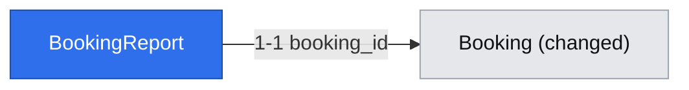

# A mentee cancels a booking (free up to 24 hours before) and can report a dispute

Status: implemented — phase 1 in #58, phase 2 (dispute reports) on branch feat/booking-reports — Q1 confirmed by the owner on 2026-11-20 (refund through the Stripe API)
Issue: #30 (E03-S02) · Epic: #18 · Depends on: #29 (`.ai/specs/implemented/2026-11-20-booking-stripe-checkout.md`, implemented in #55/#56) · Source: `.ai/specs/product-brief.md` (R10, R16, D10)

## 📝 TLDR
Today a confirmed booking (#29) cannot be undone: the mentee has no way to cancel, the money stays with the platform, and nobody can raise a problem about a session. Proposed (future behaviour): on `/bookings/[id]` the mentee cancels a confirmed booking before it starts; more than 24 hours ahead the booking is cancelled, the time reopens and the full payment is refunded through Stripe; later, the mentee is first told the fee is forfeited and must confirm. The mentee can also report a dispute about a booking; the operator sees it on `/admin` and handles it by hand, with no automatic refund (R10, R16). The mentor is told by email and sees the cancellation on `/mentor/slots`.

## 📝 Problem Statement
R10 (D10) promises free cancellation up to 24 hours before a session, forfeits the fee after that, and routes disputes to the operator with no automatic refunds; R16 makes the founders that operator, by hand. #29 deliberately left cancellation and refunds out and reserved the `cancelled` status for this story. Without it a mentee who cannot attend has no rule to rely on, which is the problem the brief names (scheduling and payment negotiated by message, with no rules).

## 📝 Proposed Solution
`BookingService.cancel` moves a `confirmed` booking to `cancelled` under the mentor profile row lock (the same lock `start` and `applyCompleted` take), records `cancelled_at`, and decides the refund once, at that moment: **free** when `now < starts_at − 24 h`, otherwise **forfeited**. The client sends the terms it showed (`expectRefund`); if the server's decision differs (the boundary passed while the dialog was open), it refuses with 409 `CANCELLATION_TERMS_CHANGED` and changes nothing, so the mentee never confirms terms they did not see (AC2). `cancelled` is not an active status, so the time reopens through the existing occupancy rules (still subject to the two-hour lead for new bookings).

A free cancellation is refunded in full after commit: the commit records `refund_status = requested`; then the Checkout gateway reads the session's PaymentIntent and creates a Stripe refund for it, idempotent by booking id (`refund-<bookingId>`). The outcome is recorded in a second update: `succeeded`, `pending` (Stripe `pending`/`requires_action`), or `failed` (deterministic rejection, or Stripe `failed`/`canceled`); Stripe's `charge_already_refunded` counts as `succeeded`. A `retryable` outcome (timeout, 5xx — Stripe may have accepted it) leaves `requested` with no `refund_id`, never `failed`, so nobody refunds by hand on a guess. Anything not `succeeded` shows on `/admin` with **Retry refund**, which reuses the same idempotency key (or, with a `refund_id`, reads the refund's current status). A refund that fails does not undo the cancellation (the mentee's decision and the reopened time stand); before refunding by hand the operator checks Stripe for a refund with `metadata.booking_id` (R16).

A **dispute report** is a short message the mentee writes about one booking (`booking_reports`, one per booking). It never changes the booking or moves money; the operator sees open reports on `/admin` and is emailed (`OPERATOR_EMAILS`), and resolves them outside the app (R10, R16).

**In scope:** `cancelled` status and cancellation columns on `bookings`; `booking_reports`; `BookingService.cancel`, `retryRefund`, `report`, the cancellation terms in `getOwn`; `applyCompleted` ignoring cancelled bookings; refund through the Checkout gateway (`refund`, `getRefund`), the Stripe stub's refund endpoints; `POST /api/bookings/[id]/cancel`, `POST /api/bookings/[id]/report`, `POST /api/admin/bookings/[id]/refund` (operator); Cancel and Report on `/bookings/[id]`; "Cancelled" on `/mentor/slots`; cancellation emails to mentee and mentor, report email to operators; a read-only "Needs attention" panel on `/admin` (open reports, refunds not succeeded, `payment_orphaned` bookings from #29).
**Out of scope:** a mentor cancelling (no story; the operator does it by hand, R16); partial refunds; resolving reports in the app (the operator logs it in the shared note, R16); refund status updates from Stripe webhooks (see Resolved assumptions Q5); a list of the mentee's bookings; rescheduling; no-show rules beyond R10.

Alternatives considered:
- **Operator refunds every free cancellation by hand.** Rejected as the default: AC1 says the payment "is returned", and the platform account (#29 Q7) can refund directly; kept as the fallback when the API refund fails. Flagged for confirmation (Q1).
- **Refund inside the transaction, roll back the cancellation on failure.** Rejected: a Stripe outage near the 24-hour boundary would cost the mentee their free cancellation; the decision is ours, the money movement is retried by the operator.
- **Store the PaymentIntent id at confirmation.** Rejected for now: needs a backfill for #29's confirmed rows; reading it from the session at refund time works for every booking.

## 📝 Architecture
- `packages/db/src/entities/bookings/booking.entity.ts` — `cancelled` added to `BOOKING_STATUSES` (CHECK widened); new columns below. `packages/db/src/entities/bookings/booking-report.entity.ts` — new. One migration (`up`/`down`).
- `packages/core/src/services/payments/checkout-gateway.ts` — `CheckoutSession` gains `paymentIntentId` (`payment_intent` is `nullable().optional()` and may be an expanded object — take its `id`; the same schema parses webhook payloads). Port gains `refund({ bookingId, sessionId })` and `getRefund(refundId)` → `{ id, status }` with Stripe's full status set (`pending | requires_action | succeeded | failed | canceled`) mapped to ours (Stripe: the existing `GET /v1/checkout/sessions/:id`, then `POST /v1/refunds { payment_intent, metadata.booking_id }`, no amount, `Idempotency-Key: refund-<bookingId>`; `GET /v1/refunds/:id`; over the existing `StripeClient` outcome classes, with the rejection code `charge_already_refunded` mapped to `succeeded`). Fake and Stripe adapter; `scripts/lib/stripe-stub.mjs` (already serves the session read) adds `payment_intent` on completed sessions, `POST /v1/refunds` and `GET /v1/refunds/:id`, recording refunds for tests.
- `packages/core/src/services/bookings/booking.service.ts`:
  - `cancel(menteeId, bookingId, { expectRefund })` — transaction: lock profile, then the booking; only the mentee's own `confirmed` booking with `starts_at > now` (else 404 / 409 `NOT_CANCELLABLE`); terms check; `status = cancelled`, `cancelled_at`, `refund_status = pending | not_due`. After commit: refund when due (outcome recorded in its own update, see Proposed Solution), `bookings.booking.cancelled` event, emails (best effort, like `announceConfirmed`). Repeating a cancel of an already cancelled booking returns its view and retries a `requested` refund (same key).
  - `retryRefund(bookingId)` — operator: `requested`/`failed` → call `refund` again (same key); `pending` with a `refund_id` → `getRefund` and record the status.
  - `applyCompleted` — a `cancelled` booking returns `ignored` (today only `confirmed`/`payment_orphaned` return early, `booking.service.ts:241`, so a redelivered completion would turn a cancelled, refunded booking into `payment_orphaned` and invite a second refund).
  - `report(menteeId, bookingId, { message })` — own booking in `confirmed` or `cancelled`; insert (unique `booking_id` → 409 `ALREADY_REPORTED`); after commit `bookings.booking.reported` and an email to each `OPERATOR_EMAILS` address (best effort).
  - `getOwn` adds `cancellation` terms, `cancelledAt`, `refundStatus`, `reportedAt`.
  - `attention()` — read for `/admin`: open reports, cancelled bookings with `refund_status` in (`pending`, `failed`), `payment_orphaned` bookings; operator only (the page guard).
- `packages/core/src/services/availability/slot.service.ts` — `OwnerSlotView.booking` gains `'cancelled'`: a slot with no active booking whose latest booking is `cancelled` (a second query in `listMine` over the listed slot ids; `activeBookingsWhere` does not return inactive rows).
- `packages/core/src/http/bookings.ts` — `cancelBooking`, `reportBooking`, `retryBookingRefund` (`requireRole('operator')`); routes `packages/app/src/app/api/bookings/[id]/cancel/route.ts`, `.../report/route.ts`, `packages/app/src/app/api/admin/bookings/[id]/refund/route.ts`.
- UI: `packages/app/src/app/(mentee)/bookings/[id]/` (Cancel dialog, Report form; shadcn panel layer, `CrudForm` for the report), `packages/ui/src/components/availability/SlotsPanel.tsx` ("Cancelled" badge), `packages/app/src/app/(admin)/admin/` (`AttentionPanel`).

Takeaway: cancellation reuses #29's lock order and after-commit pattern; the only new external call is one idempotent refund, and its failure lands with the operator, never with the mentee.

## 📝 Data Model
`bookings` (changed)
| Column | Type | Notes |
|---|---|---|
| status | text | CHECK set gains `cancelled` (widening only) |
| cancelled_at | timestamptz null | set with `cancelled` |
| refund_status | text null | `not_due` \| `requested` \| `pending` \| `succeeded` \| `failed`; CHECK on the set |
| refund_id | text null | Stripe refund id (`re_…`) |

CHECK `status <> 'cancelled' or (cancelled_at is not null and refund_status is not null)`. Rows stay financial records: never deleted.

`booking_reports` (new)
| Column | Type | Notes |
|---|---|---|
| id | uuid pk | |
| booking_id | uuid not null unique FK `bookings` `on delete restrict` | one report per booking |
| message | text not null | 20–2000 characters (`CHECK char_length`), free text about a person: shown only to the operator and the reporting mentee, never logged |
| created_at | timestamptz not null | |

## 📝 API Contracts
| Route | Auth | Input | Answer |
|---|---|---|---|
| `GET /api/bookings/[id]` (changed, additive) | owner | — | adds `cancellation: { refundDue: boolean, freeUntil: ISO } \| null` (null unless cancellable), `cancelledAt`, `refundStatus`, `reportedAt` |
| `POST /api/bookings/[id]/cancel` | owner + CSRF | `bookingCancelSchema` `{ expectRefund: boolean }` | 200 booking view; 404 not the caller's; 409 `NOT_CANCELLABLE` (not confirmed, or already started); 409 `CANCELLATION_TERMS_CHANGED` (refund decision differs from `expectRefund`); an already cancelled booking → 200 view |
| `POST /api/admin/bookings/[id]/refund` | operator + CSRF | — | 200 `{ refundStatus }`; 403 non-operator; 404; 409 `REFUND_NOT_DUE` (not a cancelled booking with a refund other than `succeeded`/`not_due`) |
| `POST /api/bookings/[id]/report` | owner + CSRF | `bookingReportSchema` `{ message: string 20–2000, trimmed }` | 200 `{ reportedAt }`; 400 validation; 404; 409 `ALREADY_REPORTED`; 409 `NOT_REPORTABLE` (status other than confirmed/cancelled) |

All `Cache-Control: no-store`; new error codes are additive (`BACKWARD_COMPATIBILITY.md`). Refund: `POST /v1/refunds` with `payment_intent` and `metadata[booking_id]`, no `amount` (full refund).

## 📝 UI/UX
- **`/bookings/[id]`, confirmed, not started**: a line with the terms — "Free cancellation until <local time>" (more than 24 h ahead) or "Cancelling now forfeits the PLN 150.00 fee." — and **Cancel booking**. The button opens a confirm dialog repeating the terms ("You will get PLN 150.00 back." / "You will not get the fee back."), with **Cancel booking** / **Keep booking**. On 409 `CANCELLATION_TERMS_CHANGED` the dialog shows the new terms and asks again.
- **cancelled**: "Cancelled on <date>." plus "Refund of PLN 150.00 is on its way (5–10 days to your card)." (`requested`/`pending`/`succeeded`), "We will refund PLN 150.00 by hand and email you." (`failed`), or "The fee was not refunded (cancelled less than 24 hours before)." (`not_due`).
- **Report a problem** (confirmed or cancelled, not yet reported): a short form; after sending, "Reported on <date>. The DevMentor team will reply by email. Reporting does not refund automatically."
- **`/mentor/slots`**: a time whose booking was cancelled shows "Cancelled by mentee" with "open again" only while it still meets the two-hour lead (otherwise "too late to rebook"), until it is booked again or passes.
- **`/admin`**: "Needs attention" — refunds not succeeded (with **Retry refund**), orphaned payments (phase 1); open reports (booking, mentee email, message, date; phase 2).
- **Emails**: mentee ("Cancelled: … — refund of … on its way" or "fee not refunded"), mentor ("Cancelled: your <length> session on <when>; the time is open again"), operators on a report. No response-time wording.

## 📝 Edge Cases & Failure Scenarios
- Exactly 24 h before → forfeited (free only when strictly more than 24 h ahead; the page shows the exact cut-off in local time).
- Dialog open across the cut-off → 409 `CANCELLATION_TERMS_CHANGED`, nothing changes, new terms shown.
- Double click / two tabs → the second cancel sees `cancelled` and returns the view; the refund idempotency key prevents a second refund.
- Stripe refund rejected → booking stays cancelled, `refund_status = failed`, logged, on `/admin`; mentee told the refund will be done by hand.
- Stripe unreachable or 5xx after it may have accepted the refund → `requested`, never `failed`; **Retry refund** (or the mentee repeating cancel) reuses the key, and an already refunded charge (`charge_already_refunded`, e.g. after the key expired) records `succeeded`.
- Process dies between the commit and the refund call → `requested` with no `refund_id`, visible on `/admin`; retry as above.
- Refund `pending` at Stripe → shown as on its way; **Retry refund** reads its current status (no webhooks, Q5).
- Session already started or past → 409 `NOT_CANCELLABLE`; the mentee can report instead.
- Cancelled time rebooked by another mentee → normal #29 flow; the mentor's "Cancelled" hint disappears because an active booking exists.
- A report on a booking another user owns → 404; a second report → 409; reporting never touches the booking or money.
- Operator email fails → logged; the report is stored and visible on `/admin`.
- A late `checkout.session.completed` redelivery for a cancelled booking → `ignored` (code change in `applyCompleted`, regression test); without it the booking would become `payment_orphaned`.

## 📝 Risks & Impact Review
`risk-high` (money and a migration): second reviewer, `needs-qa`, migration up/down test. The first outbound money movement in the product: one idempotent full refund per booking, no amount parameter, triggered only by the mentee's own cancellation more than 24 h ahead. Rollback: the migration's `down` refuses while `cancelled` rows or reports exist (they are financial records); the routes can be disabled by reverting the PR. `refund_id` lets the operator reconcile in the Stripe dashboard.

## 📝 Decisions in play
R10/D10 (24-hour free cancellation, forfeit after, operator disputes, no automatic refunds), R16 (operator by hand: failed refunds, report resolution, mentor-side cancellation), #29 Q7 (money in the platform account until #35/#26 — refunds come from it). Q1 below reads R10's "no automatic refunds" as covering disputes and late cancellations, not the free cancellation R10 itself grants; founder A owns R10.

## Resolved assumptions (autonomous defaults)
| # | Question | Default applied | Rationale |
|---|---|---|---|
| Q1 | Free cancellation: refund through the Stripe API at once, or by the operator by hand? | Stripe API refund at cancel, full amount, idempotent; operator only when it fails (confirmed by the owner 2026-11-20) | AC1 says the payment "is returned"; R10 says "no automatic refunds in 1.0" and #29's spec leaned on it. Reading it as disputes and late cancellations only is a call on an active rule owned by founder A |
| Q2 | One spec or split cancellation and disputes? | One spec, disputes as their own phase/PR | The issue bundles them as one story (AC3); the report shares the booking page and the admin panel, so a second spec would repeat the design |
| Q3 | Where is the 24-hour line? | Free only when `now < starts_at − 24 h`, decided once at cancel on the server | "More than 24 hours away" in AC1; one decision point avoids disputes about the boundary |
| Q4 | Does a cancelled time reopen when less than 24 h remain? | Yes, under the normal two-hour lead | `cancelled` is not active; the mentor keeps the chance to be booked |
| Q5 | Track refund status changes from Stripe (webhooks)? | No; record the status the refund API returns; anything not succeeded on `/admin`, where **Retry refund** re-reads a pending refund | Least new surface; card refunds usually succeed at once; the inbox can add `refund.updated` later |
| Q6 | Can a mentor cancel? | No (out of scope); the operator by hand (R16) | No story covers it; a mentor-initiated refund rule is a product decision |
| Q7 | What can be reported, and how often? | Own `confirmed` or `cancelled` bookings, one report each, 20–2000 characters | Smallest rule that serves AC3; follow-ups happen by email |
| Q8 | How does the operator see reports? | Read-only "Needs attention" panel on `/admin` plus an email to `OPERATOR_EMAILS` | Reuses the existing operator page and env; resolution is logged in the shared note (R16) |
| Q9 | How does the mentor see the cancellation (AC4)? | Email plus "Cancelled by mentee — open again" on `/mentor/slots` | There is no mentor bookings list yet; the slot view is where the mentor saw "Booked" |

## 📋 Phasing
- **Phase 1 — Cancellation and refund** (AC1, AC2, AC4): migration, `applyCompleted` fix, gateway `refund`/`getRefund` + stub, `cancel`, `retryRefund`, terms in `getOwn`, routes, `/bookings/[id]` Cancel, `/mentor/slots` "Cancelled", `/admin` "Needs attention" (refunds, orphaned payments), emails, integration test.
- **Phase 2 — Dispute reports** (AC3; its own PR): `booking_reports`, `report`, route, Report form, reports on `/admin`, operator email, integration test.

## 📋 Implementation Plan
1. Migration: `cancelled` status, `cancelled_at`, `refund_status`, `refund_id`, CHECKs; entity tests; schema integration test (CHECKs, down refused with cancelled rows). `applyCompleted` returns `ignored` for `cancelled` + regression test.
2. Gateway: `paymentIntentId` in the session schema (nullable, string or expanded object), `refund()` and `getRefund()` in the port, Stripe adapter (idempotency key, full status mapping, `charge_already_refunded` → succeeded, retryable → no status change), fake; stub: `payment_intent` on completion, `POST /v1/refunds`, `GET /v1/refunds/:id`, with unit tests.
3. `bookingCancelSchema`; `BookingService.cancel` (lock order, ownership, `NOT_CANCELLABLE`, terms check, idempotent repeat retrying `requested`, after-commit refund/event/emails), `retryRefund`; `getOwn` terms; unit tests incl. the boundary at exactly 24 h, retryable vs. rejected refunds, and a crash before the refund call.
4. `SlotService.listMine` `'cancelled'`; `SlotsPanel` badge + story; tests.
5. `POST /api/bookings/[id]/cancel` and `POST /api/admin/bookings/[id]/refund` with route tests (401, 403 CSRF and non-operator, 404, 409 codes, no-store); `/admin` `AttentionPanel` (refunds with **Retry refund**, orphaned payments).
6. `/bookings/[id]`: terms line, confirm dialog, cancelled states; component tests.
7. Integration: book → pay → cancel > 24 h ahead → stub refund recorded, time open again, mentor sees "Cancelled", emails, redelivered completion leaves it cancelled; < 24 h → forfeit terms, no refund; terms changed → 409; stub refund failure → on `/admin`, Retry refund succeeds.
8. `booking_reports` migration + entity; `bookingReportSchema`; `BookingService.report` + operator email; reports in `attention()`; unit tests.
9. `POST /api/bookings/[id]/report` with route tests; Report form on `/bookings/[id]`; reports in `AttentionPanel`; component tests.
10. Integration: report → stored once, operator email logged, visible on `/admin` for an operator and not for a mentee; booking and money unchanged.
Each step ends with `npm run validate` green at 100% coverage; steps 1, 7 and 10 run `npm run test:integration`.

## Implementation notes (phase 1)
- Cancellation lives in its own scoped `BookingCancellationService` (`cancel`, `retryRefund`, `needsAttention`); `BookingService` only gains the view fields and the `applyCompleted` guard.
- `/mentor/slots` shows "Cancelled by mentee" for a slot with no active booking that has any cancelled booking (simpler than "latest booking"; an abandoned hold after a cancellation does not change what the mentor needs to know).
- The `/admin` panel is a server component, so it renders the shadcn `Table` directly (like `SlotsPanel`): `DataTable` is a client component whose column cells are functions and cannot be passed from the server.
- A Stripe `charge_already_refunded` answer keeps an earlier `refund_id` if one was recorded.
- The integration suite pays through the stub's hosted page and uses `POST /__stub/refunds/fail-next` for the refused-refund path.

## Implementation notes (phase 2)
- Reports have their own scoped `BookingReportService` (`report`, `list`); `getOwn` reads `reportedAt` directly.
- `/admin` lists every report (newest first) in a separate "Reported bookings" section; there is no resolved state yet (R16: the operator logs the outcome in the shared note).
- The operator email names the booking id and links `/admin`; it never carries the mentee's message.

