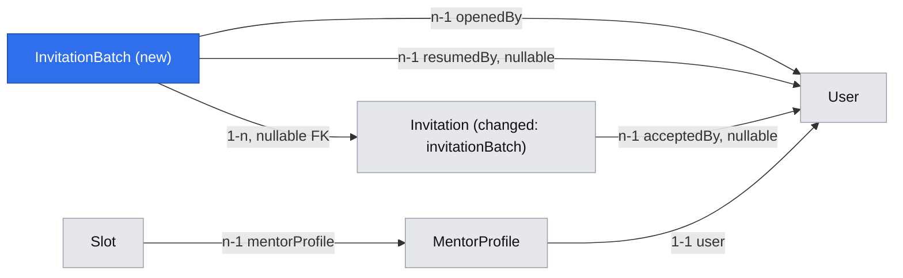

# Operators invite mentors in batches of 20 and see who published a slot within two weeks

Status: implemented (2026-11-24, PR #100; validate green; full integration suite 216/216 green on the final diff, owner run 14:15; Q2 decided as D28)
Note (2026-11-25 audit): this spec is in `implemented/` and has a capability digest (`.ai/specs/capabilities/invitation-batches.md`); Q2 is decided (D28). Sentences below saying otherwise are stale.
Source: `.ai/context/2026-11-24-lesson-21-brief.md` (lesson 21), adapting the course prompt for the reference project's issue #30 (course material, kept outside this public repository) · Brief: `.ai/specs/product-brief.md` (R13, D13, A02; also R16, D19, D24)
Extends: .ai/specs/implemented/2026-10-21-mentor-invitations.md
Supersedes: .ai/specs/implemented/2026-10-21-mentor-invitations.md — sections: Proposed Solution (out of scope: "enforcing batches of 20 and the two-week report"; `create` printing the link for the operator to send by hand)

## 📝 TLDR
Operators (the two founders, D19) invite senior engineers from the beachhead pool with `npm run invite -- create`, copy the printed link into an email by hand, and count in a shared note who published a slot. R13 and D13 make the invitation the test of A02: batches of 20, one published session within two weeks of accepting, and fewer than 5 of the first 20 publishing stops further invitations. Proposed (future behaviour): an operator-only page `/admin/invitations` opens numbered batches of at most 20, sends each invitation by email from the one service method the CLI also uses, shows every invitation's status in words with per-batch counts, and refuses new invitations and batches once the D13 stop rule fires.

## 📝 Problem Statement
- The counting that D13 depends on is manual and error-prone: the free-text `invitations.batch` label does not cap a batch at 20, and `npm run invite -- list` shows a "D13" column computed from slots that are bookable *now* (`InvitationService.withD13` → `SlotService.countBookable`), not from what the mentor published inside their window. A mentor who published on day 3 and was fully booked by day 20 reads as `missed`.
- Nothing stops a 21st invitation, a second open batch, or invitations after the D13 stop. The stop exists only as a sentence in the brief.
- The link travels by hand: the operator copies it from the terminal, so the raw token sits in terminal scrollback and chat history.

## 📝 Proposed Solution
A new `InvitationBatch` entity (numbered, at most one open), a nullable foreign key from `invitations` to it, and pure rule functions (status, counts, stop) evaluated per request with the injected `Clock`. `InvitationService.create` becomes the single path that creates an invitation: it applies the batch and stop rules under a lock on the open batch, inserts the row, sends the email inside the same transaction and commits only after the mailer accepted it. The operator page and `npm run invite -- create` both call it. A new `InvitationBatchService` opens batches and builds the operator overview.

Alternatives considered:
- *Reuse the free-text `batch` column as the batch number.* Lost: existing rows hold arbitrary labels (`b1`, `2026-10-a`); parsing them is guesswork and they cannot carry `openedBy` or `resumedAt`.
- *Backfill old invitations into a "batch 0" and make the FK `NOT NULL`.* Lost: tightening a constraint over existing data is breaking (`BACKWARD_COMPATIBILITY.md`, Database schema). Old rows keep a null FK and show under "Created before batches"; the service guarantees every new row gets a batch.
- *Store the D13 decision (a `decidedAt` written by a job).* Lost: the course decides "computed on every request"; the inputs (20 rows, their slots) are small, and nothing needs a scheduler.
- *Send the email after the commit (as `AccountService.startRegistration` does).* Lost: a mail failure would leave an invitation that counts toward the 20 and blocks the address with "already has an unresolved invitation", for an email nobody received.

## 📝 Rules
These definitions are used verbatim in code, tests and copy.

1. **Batch.** Numbered 1, 2, 3 … in the order opened. Holds at most `INVITATION_BATCH_SIZE = 20` invitations (a constant in `core`, not an env var). Every invitation created in a batch counts toward its 20, including ones later revoked or expired. A batch never reopens.
2. **Open batch.** At most one batch accepts invitations at a time (`closedAt` null). A batch closes (`closedAt = now`) in the same transaction that creates its 20th invitation. Opening the next batch is a separate operator action, allowed only when no batch is open and invitations are not stopped. Only the page opens batches; the CLI never does.
3. **Invitation status**, evaluated at `now = clock.now()`, first match wins:
   1. "Revoked": `revokedAt` set.
   2. "Waiting for acceptance": not accepted, `expiresAt > now`.
   3. "Expired, not accepted": not accepted, `expiresAt <= now`.
   4. "Published a slot": accepted, and the accepting user's mentor profile has at least one slot with `createdAt >= acceptedAt` and `createdAt <= publishDueAt`. Removed slots (`removedAt` set) count. A slot created before `acceptedAt` never counts (a re-invited mentor).
   5. "Accepted, no slot yet": accepted, no such slot, `now <= publishDueAt`.
   6. "No slot within two weeks": accepted, no such slot, `now > publishDueAt`. A slot created after `publishDueAt` does not change this.

   `publishDueAt` is the value stored on acceptance (`acceptedAt + MENTOR_PUBLISH_WINDOW_DAYS`), never recomputed and never a hard-coded 14.

   An accepted invitation with a null `publishDueAt` (accepted before the column existed) has no known deadline: any slot with `createdAt >= acceptedAt` makes it "Published a slot"; otherwise it stays "Accepted, no slot yet" for good, never "No slot within two weeks". Because "Accepted, no slot yet" keeps a batch undecided, such a row never decides batch 1 by itself (amendment after the spec review, 2026-11-24).
4. **Batch counts.** Sent = invitations in the batch. Accepted = invitations with `acceptedAt` set (a later revoke cannot happen: `revoke` refuses accepted invitations). Published = invitations with status "Published a slot".
5. **Stop rule (D13), batch 1 only.** Batch 1 is *decided* when it holds 20 invitations and none of them is "Waiting for acceptance" or "Accepted, no slot yet". If batch 1 is decided and Published < 5, invitations are **stopped**: no invitation can be created in any batch and no batch can be opened, until batch 1 has `resumedAt` set. Nothing in this spec sets `resumedAt`. The stop is computed on every request that needs it, never by a scheduled job and never stored.
6. **No re-arming while stopped.** While invitations are stopped, every path that re-arms an invitation refuses with 409 `INVITATIONS_STOPPED` and the stopped message word for word, and writes nothing. Today the only such path is `InvitationService.resend` (new token and expiry, reached by `npm run invite -- resend`); the refusal applies to an invitation of any batch and to ones created before batches. Without it, resending an expired batch-1 invitation makes it "Waiting for acceptance" again, un-decides batch 1 and lifts the stop. Decided by the run in autonomous mode after both spec reviewers flagged it (formerly Q3); the owner may override.

**Clarification of R13/D13.** In this task "published a bookable session" (R13, D13) is measured as "created at least one slot in the window" (rule 3.4). Reason: creating a slot is the mentor's act of publishing a time; page publication and prices are separate checks. Decided 2026-11-24 by the session owner (Q2 answered: keep "created a slot"); recorded in the brief as D28 in this change, per lesson 2026-11-23.

Batch state label on the screen: "Stopped" for batch 1 and for the open batch while invitations are stopped; otherwise "Open" (`closedAt` null) or "Full".

## 📝 Delta

### Capability: invitation-batches

#### ADDED Requirement: Batches of at most 20, one open at a time
The system SHALL create every new invitation in the single open batch, close that batch when its 20th invitation is created, and let an operator open the next batch only when none is open and invitations are not stopped.

##### Scenario: The 21st invitation
- WHEN batch N holds 20 invitations and an operator submits another
- THEN the answer is 409 "This batch is full; open a new batch." and no row is written

##### Scenario: Losing the race for the 20th invitation
- WHEN two operators submit the 20th invitation of batch N at once and the other request closes batch N first
- THEN after taking the lock the loser finds no open batch and the latest batch closed, and answers 409 `BATCH_FULL` "This batch is full; open a new batch." (never `NO_OPEN_BATCH`, which is only for "no batch exists at all"); batch N ends with 20

##### Scenario: Opening while a batch is open
- WHEN a batch is open and an operator opens another
- THEN the answer is 409 "A batch is already open." and no batch is created

#### ADDED Requirement: Invitation status in words
The system SHALL show each invitation's status as exactly one of the six words of rule 3, evaluated at the injected clock's now.

##### Scenario: Slot exactly at the deadline
- WHEN an accepted mentor's only slot was created exactly at `publishDueAt`
- THEN the status is "Published a slot"

#### ADDED Requirement: D13 stop
The system SHALL refuse new invitations and new batches once batch 1 is decided with fewer than 5 "Published a slot", until batch 1 has `resumedAt`.

##### Scenario: 4 of 20
- WHEN batch 1 is decided with 4 publishers
- THEN creating an invitation or opening a batch answers 409 with the stopped message and the page shows the banner without form or open button

##### Scenario: 5 of 20
- WHEN batch 1 is decided with 5 publishers
- THEN invitations are not stopped

#### ADDED Requirement: Operator actions are logged
The system SHALL log every operator action of this spec with the existing T-14 pattern `logger.info({ operator: { id }, action, target }, 'Operator action')` (as `http/payouts.ts` does): `invitation-batch.open` (target `{ batch: { number } }`), `invitation.create` (target `{ invitation: { id }, batch: { number } }`) and `invitation.resend` when it succeeds (target `{ invitation: { id } }`); and SHALL log every request refused because invitations are stopped. No log line carries the token, token hash, link or invited email.

##### Scenario: Refused while stopped
- WHEN invitations are stopped and an operator creates an invitation, opens a batch or resends
- THEN the request is refused and one line `{ operator, action, refused: 'INVITATIONS_STOPPED' }` with message 'Operator action refused' is logged

#### ADDED Requirement: Invitation email before commit
The system SHALL email the invitation to the invited address before committing the invitation; when the mailer rejects, nothing is saved.

##### Scenario: Mailer down
- WHEN the mailer rejects
- THEN the answer is 503 "The invitation email could not be sent. Nothing was saved; try again.", the batch count is unchanged and the same email can be submitted again

### Capability: mentor-invitations

#### MODIFIED Requirement: Create an invitation with the invite CLI
The system SHALL create an invitation from `npm run invite -- create --email <e> --tags <t,...> [--batch <label>] --operator <name>` only in the open batch and under the stop rule, email the link to the invited address, and print a confirmation and the token-free audit line. It SHALL print the link only when `MAIL_PROVIDER=log` (no email leaves the machine, so the operator needs the link, as today); with `MAIL_PROVIDER=resend` it never prints the link.

##### Scenario: CLI create with an open batch
- WHEN an operator runs `create` with `MAIL_PROVIDER=resend` while batch N is open with fewer than 20 invitations
- THEN the invitation is created in batch N, the email goes out, stdout shows "Invitation emailed to <email> (batch N, x of 20)." and the audit line, and no link is printed

##### Scenario: CLI create with the log mailer
- WHEN an operator runs `create` with `MAIL_PROVIDER=log` (local development, integration tests)
- THEN stdout shows "MAIL_PROVIDER=log: the email was not delivered." and the existing link block ("Invitation link for <email> (shown once; send it by hand):" and the link), then the confirmation "Invitation created for <email> (batch N, x of 20)." (not "emailed": nothing was delivered) and the audit line; nothing else (stderr, logs) carries the link

##### Scenario: CLI create with no open batch
- WHEN no batch was ever opened
- THEN the CLI exits 1 with "No batch is open yet; open the first batch." and nothing is written

#### MODIFIED Requirement: Resend an invitation with the invite CLI
The system SHALL refuse `npm run invite -- resend <id>` while invitations are stopped (rule 6): `InvitationService.resend` throws 409 `INVITATIONS_STOPPED` with the stopped message before it touches the row; the CLI prints the message and exits 1. When not stopped, `resend` keeps its behaviour (prints its new link) and, new, logs one 'Operator action' line `invitation.resend` with `operator: { cli: 'invite-cli' }` (resend takes no `--operator`) and target `{ invitation: { id } }`.

##### Scenario: Resend while stopped
- WHEN batch 1 is decided with 4 publishers and an operator resends an expired batch-1 invitation
- THEN the answer is 409 `INVITATIONS_STOPPED` with the stopped message, the token hash and `expiresAt` are unchanged, and batch 1 stays decided

Frozen by: `packages/core/src/cli/invite-cli.test.ts` (create prints the link block and audit line), `packages/core/src/services/invitations/invitation.service.test.ts` (create without batch) — these pin today's behaviour in step 4 and are rewritten to the scenarios above in steps 7–8.

## 📝 Architecture
Existing / changed / new, by package (paths from the repo root):

- **db** (new) `packages/db/src/entities/invitations/invitation-batch.entity.ts`, registered in `entities/index.ts`; (changed) `invitation.entity.ts` gains `invitationBatch` (nullable `manyToOne`); (new) `packages/db/src/migrations/Migration20261124100000.ts`.
- **core**
  - (new) `services/invitations/invitation-batch.rules.ts` — pure functions: `invitationStatus(row, publishedSlotAt, now)`, `batchCounts(rows)`, `stopState(batch1, rows, now)`, constants `INVITATION_BATCH_SIZE`, `D13_MIN_PUBLISHED = 5`, the refusal messages. No `@devmentor/db` constants at module scope (lesson 2026-10-26).
  - (new) `services/invitations/invitation-batch.service.ts` — `InvitationBatchService`: `open(user)`, `overview(user)`, `assertNotStopped(em, now, operator, action)` (used by `open` and `resend`) and `assertCanInvite(em, now, operator, action)` (stop → open-batch lock → stop again → count) used by `InvitationService.create`. Registered `scoped` in `container/container.ts` and `container/cradle.ts`.
  - (changed) `services/invitations/invitation.service.ts` — `create(input, actor)` applies rules 1, 2 and 5, sends the email inside the transaction, maps the existing refusals to new codes; `resend` checks the stop first (rule 6) and logs its stopped refusal; `revoke`, `list`, `find`, `lookup`, `accept` unchanged.
  - (new) `services/invitations/invitation-mails.ts` — `invitationMail(to, link, expiresAt, windowDays)`, plain text (pattern: `services/auth/account-mails.ts`).
  - (new) `validators/invitations/invitation-create.schema.ts`, exported from `@devmentor/core/validators` — shared by the API and `CrudForm`.
  - (new) `http/invitation-batches.ts` — handlers `getInvitationBatches`, `openInvitationBatch`, `createInvitation` (pattern: `http/payouts.ts`), exported from `@devmentor/core/http`.
  - (changed) `cli/invite-cli.ts` — `create` passes a CLI actor and prints a confirmation (plus the link block only with `MAIL_PROVIDER=log`); the hand-built service graph gains `InvitationBatchService` and a mailer picked by a new `cliMailSender(env, logger)` (see API Contracts → CLI).
  - (changed) `services/invitations/invitation-batch.service.ts` overview rows name the mentor with the existing `mentorNameForOperator` (`services/mentors/mentor-name.ts`), never `displayName` inline (the lesson-17 ESLint rule on core services).
- **app**
  - (new) `packages/app/src/app/api/admin/invitation-batches/route.ts` (`GET`, `POST`) and `packages/app/src/app/api/admin/invitations/route.ts` (`POST`) — wiring only.
  - (new) `packages/app/src/app/(admin)/admin/invitations/page.tsx`, `InvitationsContent.tsx` (server: `requirePageRole("/admin/invitations", "operator")`, tag options from `StackTags.options()`), `InvitationsBoard.tsx` (client: `apiCall`, `CrudForm`, confirm dialog, sections).
- **ui**
  - (new) `packages/ui/src/components/invitations/InvitationBatchSection.tsx` — heading, state label, counts line, `DataTable` of rows; `invitationStatusLabel` maps API status codes to the rule-3 words. Exported from `@devmentor/ui`. Story: `packages/ui/stories/product/e01/InvitationBatches.stories.tsx`.
  - (changed) `packages/ui/src/time/LocalTime.tsx` — additive `format: "long-date"` ("24 November 2026"); existing formats unchanged.
  - (changed) `packages/ui/src/components/auth/accountNav.ts` — Admin section: "Dashboard", then "Invitations" (`/admin/invitations`).

Lock order in `create`: open batch row → invitee's user row (existing) → insert. `accept` locks user → invitation and never the batch, so no cycle. No new domain event: nothing consumes one yet.

## 📝 Data Model

`invitation_batches` (new)
| Column | Type | Notes |
|---|---|---|
| id | uuid pk | |
| number | integer not null, unique (`invitation_batches_number_uq`) | `CHECK (number > 0)`; next = max + 1, computed in the open transaction |
| opened_by_id | uuid not null, FK `users` on delete restrict, indexed | the operator who opened it |
| opened_at | timestamptz not null | from the Clock |
| closed_at | timestamptz null | set with the 20th invitation |
| resumed_at | timestamptz null | lifts the D13 stop on batch 1; never written in this spec |
| resumed_by_id | uuid null, FK `users` on delete restrict | `CHECK ((resumed_at is null) = (resumed_by_id is null))` |
| created_at, updated_at | timestamptz | |

Partial unique index `invitation_batches_one_open_uq` on `((closed_at is null)) where closed_at is null`: at most one open batch, enforced by the database (a plain unique on a nullable column would not, NULLs are distinct). Spike the expression index in MikroORM 7's `uniques` first; if it cannot be declared, the migration creates it and the entity comment names it.

`invitations` (changed): `invitation_batch_id uuid null`, FK `invitation_batches` on delete restrict, indexed. The existing `batch text null` column is untouched: the CLI's `--batch` label keeps writing it.

Migration `Migration20261124100000`: `up` creates the table, its constraints and indexes, then adds the column, FK and index on `invitations`; `down` drops the column (with its FK and index) and then the table. No data migration.


Status "Published a slot" walks Invitation → acceptedBy User → MentorProfile → Slot (`createdAt` in `[acceptedAt, publishDueAt]`); `Slot` already has `createdAt` and soft delete (`removedAt`).

Sensitive data: invited emails and mentor names reach operators only (page and routes are operator-only, `Cache-Control: no-store`). The raw token exists only in the email body.

## 📝 API Contracts

All three routes go through `apiHandler` (CSRF on for POST), `requireSession` (401) and `requireRole(user, 'operator')` (403); the services repeat the operator check on the session actor (403 `ForbiddenError`). Responses carry `Cache-Control: no-store`. No response contains a token, token hash or link. Operator actions log with the T-14 pattern `logger.info({ operator: { id }, action, target }, 'Operator action')` (`http/payouts.ts`): `invitation-batch.open` → `{ batch: { number } }`, `invitation.create` → `{ invitation: { id }, batch: { number } }`, `invitation.resend` (CLI, not stopped, after the commit) → `{ invitation: { id } }`. A CLI actor logs `operator: { cli: '<name>' }` (no user id). A refusal because invitations are stopped logs `{ operator, action, refused: 'INVITATIONS_STOPPED' }` with 'Operator action refused' (also for `invitation.resend`). Never an email, token, token hash or link.

| Route | Request | Success | Refusals |
|---|---|---|---|
| `GET /api/admin/invitation-batches` | — | 200 `InvitationOverview` | 401, 403 |
| `POST /api/admin/invitation-batches` | no body | 201 `{ number, openedAt }` | 409 `BATCH_ALREADY_OPEN`, 409 `INVITATIONS_STOPPED` (checked first), 401, 403 |
| `POST /api/admin/invitations` | `{ email, stackTags }` | 201 `{ id, email, batchNumber, sent }` | 400 `VALIDATION_ERROR`, 409 `INVITATIONS_STOPPED`, `NO_OPEN_BATCH`, `BATCH_FULL`, `EMAIL_IS_MENTOR`, `ALREADY_INVITED`; 503 `INVITATION_MAIL_FAILED`; 503 `SERVICE_UNAVAILABLE` without `APP_URL` (existing); 401, 403 |

```ts
type InvitationOverview = {
  stopped: boolean;
  canOpen: boolean;            // no open batch and not stopped
  nextBatchNumber: number;     // 1 when none exists
  batches: BatchView[];        // newest first
  beforeBatches: InvitationRow[]; // rows with a null FK, oldest first; [] when none
};
type BatchView = {
  number: number;
  state: 'open' | 'full' | 'stopped';
  openedAt: string; closedAt: string | null;
  counts: { sent: number; accepted: number; published: number };
  invitations: InvitationRow[]; // oldest first
};
type InvitationRow = {
  id: string; email: string;
  mentorName: string | null;   // null before acceptance; after it mentorNameForOperator(displayName, accepting user's email): the email when the name is null, empty or whitespace
  stackTags: StackTagKey[];
  status: 'revoked' | 'waiting' | 'expired' | 'published' | 'accepted_no_slot' | 'no_slot_in_window';
  publishDueAt: string | null; // ISO, accepted only
};
```

**Schema** `invitationCreateSchema` (`z.strictObject`, unknown fields refused): `email` = existing `emailField` (trim, lower-case, ≤ 254, valid address); `stackTags` = array of `StackTags` keys, at least 1 ("Pick at least one stack tag."), at most 4, duplicates refused ("Each stack tag only once."), unknown keys refused. Parsed output goes to the service (`parseJsonBody`).

**Refusal messages, word for word**
| Case | Status, code | Message |
|---|---|---|
| no batch exists at all | 409 `NO_OPEN_BATCH` | No batch is open yet; open the first batch. |
| no open batch and the latest batch closed (full), including the loser of the 20th-invitation race | 409 `BATCH_FULL` | This batch is full; open a new batch. |
| opening while a batch is open | 409 `BATCH_ALREADY_OPEN` | A batch is already open. |
| stopped (create, open, resend) | 409 `INVITATIONS_STOPPED` | Invitations are stopped: fewer than 5 of the first 20 published a slot within two weeks. Interview the decliners first. |
| mail failure | 503 `INVITATION_MAIL_FAILED` | The invitation email could not be sent. Nothing was saved; try again. |
| pending invitation | 409 `ALREADY_INVITED` | existing `ALREADY_INVITED_MESSAGE` |
| existing mentor | 409 `EMAIL_IS_MENTOR` | existing `EMAIL_IS_MENTOR_MESSAGE` |

The two existing messages gain specific codes (today the default `CONFLICT`); no HTTP route or UI branches on them today, so this is additive. Order in `create`: schema (400) → `APP_URL` (503) → stopped → open batch (none / full) → existing mentor → insert (pending duplicate) → mail.

**Email** (`MailSender.send`, plain text, to the normalized address): subject "You are invited to mentor on DevMentor"; body: the link `<APP_URL>/invitation/<token>`, "The link works once and expires on <expiresAt, e.g. 8 December 2026, 14:05 UTC>.", and the R13 ask "After you accept, publish at least one bookable session within <MENTOR_PUBLISH_WINDOW_DAYS> days." Times in UTC (no viewer time zone in an email).

**Service flow of `create`** (one transaction): stop check → `SELECT … FOR UPDATE` on the open batch (refresh) → if none is open after the lock: `BATCH_FULL` when any batch exists (the latest is closed), `NO_OPEN_BATCH` only when no batch exists at all → stop check again, after the lock (a revoke or slot committed while waiting may have decided batch 1; refused with `INVITATIONS_STOPPED`) → count its invitations → existing-mentor check under the user-row lock (unchanged) → insert with `invitationBatch` and the legacy `batch` label → `flush` → if the count is now 20, `closedAt = now` → `mailSender.send` → commit → log `invitation.create`. A rejected send (any error) rolls the transaction back and rethrows as `INVITATION_MAIL_FAILED`. A `UniqueConstraintViolationException` keeps mapping to `ALREADY_INVITED`.

**Actor.** `create(input, actor)` with `actor = { kind: 'session', user: SessionUser } | { kind: 'cli', operator: string }`. A session actor must hold `operator` (else 403). The CLI actor is trusted like today's CLI: it already needs `DATABASE_URL`.

**CLI (`npm run invite -- create`).** Same flags; `--tags` keeps accepting display names and duplicates (the CLI de-duplicates before calling the service, as today). Today's hand-built graph cannot use `createMailSender` as is: it needs `fetchJson`, which only the container builds, and its `MAIL_PROVIDER=log` warning would reach stderr; and `cliLogger` keeps only `warn` and above (`logger.level = 'warn'`, prints `msg` only), so `LogMailer`'s info line `mail.sent` would vanish and the operator would never see the link. So `invite-cli.ts` gets `cliMailSender(env, logger)`: `MAIL_PROVIDER=resend` → `new ResendMailer({ env, logger, fetchJson: createFetchJson({ logger }) })` (`http/outbound.ts`, same timeout and error mapping as the app); `log` → `new LogMailer({ logger })`, whose info line `cliLogger` still drops. With `log`, `executeInviteCommand` prints "MAIL_PROVIDER=log: the email was not delivered." and the existing link block from the `link` that `InvitationService.create` returns to its in-process callers (the HTTP handler maps the result to `{ id, email, batchNumber, sent }` and never passes `link` on). `cliLogger` stays at `warn`, so the token reaches no log; the link appears on stdout only, only in log mode — today's behaviour. Output: "Invitation emailed to <email> (batch N, x of 20)." (with `resend`) or the log-mode lines above, then the audit line, which gains `batch=<label or ->` unchanged and a new `in-batch=N`. `revoke` and `list` are unchanged; `resend` refuses while stopped (rule 6: stopped message, exit 1) and otherwise still prints its new link. README "Invite a mentor" is updated (the course's `docs/DEVELOPMENT.md` does not exist here).

## 📝 UI/UX
Page `/admin/invitations`, heading "Invitations", inside the `(admin)` shell; nav link "Invitations" right after "Dashboard" in the Admin section, visible only to operators. `InvitationsContent` calls `requirePageRole("/admin/invitations", "operator")` itself (the layout guard does not re-run on client navigation); a mentor or mentee is redirected to their home with the existing `operator_only` notice, as `/admin` does. Loading, error and empty states use the shared `feedback/` components.

Top of page, by state (from `InvitationOverview`):
- **Stopped:** a destructive `Alert` with the stopped message word for word. No form, no open button.
- **No batch yet:** "No batches yet. Open the first batch to start inviting." and the button "Open batch 1".
- **No open batch** (last one full): "This batch is full. Open a new batch to invite more." and the button "Open batch N".
- **Open batch:** the invite form.
- Opening asks in an alert dialog: "Open batch N? It takes up to 20 invitations." (Confirm "Open batch N", Cancel). A 409 shows in the dialog's place as an error message and the overview reloads.

Invite form — `CrudForm` with `invitationCreateSchema`:
- Email: `type: "email"`, required. Invalid input ("anna", "anna@", "anna@example", only spaces, more than 254 characters) shows the error under Email and sends no request.
- Stack tags: `type: "multiselect"`, the four `StackTags.options()` as checkboxes, no free-text input; none selected shows the error under the tags and sends no request.
- Button "Send invitation", disabled while sending (`CrudForm` loading); a double click sends one request, and a second request for the same address would be refused by the unique index anyway.
- Server refusals: `ALREADY_INVITED` and `EMAIL_IS_MENTOR` under Email (the board's `onSubmit` adapter moves the message into `fieldErrors.email` and clears the form-level message, so `CrudForm` itself is unchanged); `BATCH_FULL`, `NO_OPEN_BATCH`, `INVITATIONS_STOPPED`, `INVITATION_MAIL_FAILED` as the form error above the button. Typed values stay after any error. After a batch-state refusal the overview reloads, so the form gives way to the right top-of-page state.
- Success: a status message "Invitation sent to <email>", the form is cleared (remounted with a new `key`), and the overview reloads through `apiCall` without a page reload.

Sections — one `InvitationBatchSection` per batch, newest first: heading "Batch N", state label "Open", "Full" or "Stopped", the line "x of 20 sent, y accepted, z published within two weeks", and a `DataTable`:
| Column | Content |
|---|---|
| Mentor | `mentorName` with the email under it when the two differ; the email alone before acceptance (`mentorName` null) or when `mentorNameForOperator` fell back to the email |
| Stack tags | labels, comma separated ("TypeScript, React") |
| Status | the rule-3 words |
| Publish by | `publishDueAt` via `LocalTime format="long-date"` ("8 December 2026"); "Not accepted" otherwise |

A last section "Created before batches" (same columns, no counts, no state label) appears only when `beforeBatches` is not empty. Every cell shows explicit text; never empty, "undefined", "null", "NaN", "Invalid Date", an ISO string or a raw code. Usable at 390 px without horizontal page scroll (the table scrolls inside its own container, as `DataTable` does); every control labelled and keyboard-reachable.

Prototype: none accepted; the screen follows the panel patterns in `docs/design-system.md`.

## 📝 Edge Cases & Failure Scenarios
- 21st invitation in a batch → 409 `BATCH_FULL`; nothing saved.
- Two operators adding the 20th invitation at once → the batch-row lock serializes them: one succeeds and closes the batch; the other, after taking the lock, finds no open batch and the latest batch closed and gets `BATCH_FULL` (not `NO_OPEN_BATCH`); the batch ends with 20.
- Two operators opening a batch at once → the unique indexes (`number`, one-open) let one insert win; the loser's violation maps to `BATCH_ALREADY_OPEN`; exactly one batch is created.
- Opening while another request is closing batch N (20th invitation, not yet committed) → the open sees batch N as open and answers `BATCH_ALREADY_OPEN`; a retry succeeds.
- Status boundaries: slot at exactly `acceptedAt` counts; at exactly `publishDueAt` counts; 1 ms after does not. `now` exactly at `publishDueAt` is still "Accepted, no slot yet". `expiresAt` exactly at `now` is "Expired, not accepted".
- A slot created inside the window and removed later still counts; a slot created before `acceptedAt` (re-invited mentor) does not; a slot of another mentor never counts.
- An accepted row with a null `publishDueAt` (accepted before the column existed, or by hand SQL): no deadline is known (rule 3) — a slot created after `acceptedAt` → "Published a slot", otherwise "Accepted, no slot yet", never "No slot within two weeks"; such a row keeps its batch undecided, so it never decides batch 1. Its "Publish by" cell reads "No deadline recorded".
- Stop rule: 4 of 20 stops, 5 do not; nothing is decided while one batch-1 invitation is still waiting or inside its window; batch 1 with fewer than 20 is never decided; a batch 2 opened before batch 1 decided stops too once it decides; `resumedAt` on batch 1 lifts the stop.
- `npm run invite -- resend` while stopped → 409 `INVITATIONS_STOPPED`, row unchanged, CLI exit 1 (rule 6).
- Concurrency with the stop: the stop is computed per request from what is committed when it is read; a change committed concurrently (a slot, an acceptance, a revoke, or time passing a deadline) is seen by the next request. Such a change can move batch 1 either way — e.g. the last waiting invitation revoked, or the last undecided mentor publishing as the 4th, decides batch 1 as stopped. To keep that window small, `create` evaluates the stop before and again after taking the open-batch lock, inside the same transaction, and refuses with `INVITATIONS_STOPPED` if it applies now (a change committed while it waited for the lock is seen). A change committed after that second check (slots and revokes never take the batch lock) is seen by the next request; at most that one in-flight `create` slips through.
- Same address with a pending invitation, or an existing mentor → existing messages, under Email. Different case or surrounding spaces are the same address (schema trims and lower-cases).
- Mailer failure → 503 `INVITATION_MAIL_FAILED`, nothing saved, count unchanged, retry with the same email works.
- **Known limitation — mailer timeout after the provider accepted the message.** `fetchJson` gives up after `DEFAULT_OUTBOUND_TIMEOUT_MS`; if Resend accepted the message but its answer arrived late, `send` rejects, the invitation is rolled back (503 `INVITATION_MAIL_FAILED`) and the email may still arrive. Its link points to an invitation that does not exist, so the acceptance page shows its existing not-found message ("This invitation is not valid."); the operator, told "Nothing was saved; try again.", re-invites and the invitee gets a second, working email. Not fixed here (an idempotent provider call is out of scope); no extra test, since it is the same rollback path as the mail-rejection test.
- Mailer accepted but the commit fails (database lost between `send` and `COMMIT`) → the invitee holds a link to a row that does not exist; the invitation page says "This invitation is not valid."; the operator sees no row and invites again. Accepted as rare; logged as an error with the invited address omitted.
- The mailer is called while the open batch row and the invitee's user row are both held `FOR UPDATE`: other creates serialize behind at most the outbound timeout (10 s, `DEFAULT_OUTBOUND_TIMEOUT_MS`), and so does anything that locks that user row — `accept`, `AccountService.resendVerification` and `setPasswordFromLink`, and a booking start by that person (`BookingService` locks the mentee row) — for that one invitee only. Acceptable at two operators and 20 invitations per batch.
- `APP_URL` unset → 503 (existing), checked before anything is written.
- Mentee, mentor (without operator) and signed-out visitor: redirected on the page, 403/401 on every route, no "Invitations" link.
- An operator who is also a mentor (seeded `mock-operator`) can open batches and invite; inviting their own address is refused as an existing mentor.

## 📝 Risks & Impact Review
`risk-high` (`SDLC.md` infers `risk-high` for schema migrations): a new table and a nullable column (additive, `up`/`down`), three new routes behind the operator role, and one changed operator workflow. Not reversible without data loss once used: dropping the table loses batch numbers and `openedBy`; `down` is for development and the integration test, not for production after batches exist. Gates: `needs-qa` with a QA reviewer (or a maintainer's exception stated on the PR); no self-QA sign-off (`om-auto-qa-pr --self-qa-signoff` / `qa-self-verified` not allowed on this PR).

Behaviour change for the founders: after deploy, `npm run invite -- create` refuses until someone opens batch 1 on the page, and with `MAIL_PROVIDER=resend` it no longer prints the link (the email carries it); with `MAIL_PROVIDER=log` (local development) it still prints it. Announce in the PR body and the README.

Compatibility (`BACKWARD_COMPATIBILITY.md`): database — additive only, no tightened constraint, no renamed or dropped column; HTTP routes — new only; error codes — new codes, none repurposed; package entries — additions to `@devmentor/core/http`, `@devmentor/core/validators`, `@devmentor/ui` (`InvitationBatchSection`, `invitationStatusLabel`, `LocalTime` `long-date`), nothing removed; env — none added; root scripts — `invite` stays with the same flags.

## 📝 Decisions in play
R13 / D13 / A02 (batches of 20, the two-week ask, the stop rule; owners: both founders), R16 / D19 (the founders are the operator; operator authority from `OPERATOR_EMAILS`), D24 (beachhead stack tags). The spec enforces D13 in the product and clarifies one term of R13/D13 (see "Clarification of R13/D13" under Rules: "published a bookable session" = "created at least one slot in the window"); Q2 is answered and the brief gets decision row D28 in this change (lesson 2026-11-23). The `Supersedes:` line concerns only the older invitations spec. When Q1 is answered, the implementation PR records the answer in the brief (lesson 2026-11-23).

## ✅ Acceptance criteria
- AC1 Given no batch, when an operator opens batch 1 and sends an invitation to a valid address with one stack tag, then the invitee receives the email with the link, expiry and ask, and the page shows "1 of 20 sent, 0 accepted, 0 published within two weeks" and the row "Waiting for acceptance".
- AC2 Given a batch with 20 invitations, when another is submitted (screen or CLI), then it is refused with "This batch is full; open a new batch." and nothing is saved; the page shows no form and "Open batch N".
- AC3 Given batch 1 decided with fewer than 5 publishers, then the page shows the stopped banner with no form and no open button, and both routes and the CLI (`create` and `resend`) refuse with the stopped message, and each refusal is logged.
- AC4 Given an accepted invitation, then its status follows rule 3 at every boundary listed in Edge Cases, and the counts follow rule 4.
- AC5 Given a mentee, a mentor without the operator role, or a signed-out visitor, then the page and every route refuse them and the nav has no "Invitations" link; the operator's data is unchanged after their attempts.
- AC6 Given a mailer failure, then the answer is 503 with the mail message, nothing is saved, and the same address can be invited again.
- AC7 No API response, log line (other than `LogMailer`'s in the app) or CLI `create` output with `MAIL_PROVIDER=resend` contains the raw token or the link; with `MAIL_PROVIDER=log` the CLI prints the link on stdout only, never on stderr or in a log line.
- AC8 Given an operator opens a batch, creates an invitation or resends one while not stopped, then one 'Operator action' line is logged (`invitation-batch.open` with the batch number; `invitation.create` with the invitation id and batch number; `invitation.resend` with the invitation id), never with the token, link or email.
- AC9 Given two operators racing for the 20th invitation, then the loser gets 409 `BATCH_FULL`, never `NO_OPEN_BATCH`.

## 🧪 Tests
Unit (Vitest, fake `Clock`, 100% coverage; new files are covered by the existing `coverage.include` globs):
- `invitation-batch.rules.test.ts` — every status and boundary, removed slot, slot before acceptance, other mentor's slot, null `publishDueAt`, counts, stop rule 4/5, undecided while waiting or in window, fewer than 20, `resumedAt`, state labels.
- `invitation-batch.service.test.ts` — open: first, next number, already open, stopped (with the 'Operator action refused' log), unique-violation mapping, non-operator 403, `invitation-batch.open` log with `{ batch: { number } }`; overview shape, ordering, `beforeBatches`, `mentorName` through `mentorNameForOperator` (null before acceptance; a name; null, empty and whitespace-only names → the accepting user's email).
- `invitation.service.test.ts` — create: no batch ever (`NO_OPEN_BATCH`), full, no open batch after the lock with the latest batch closed → `BATCH_FULL` (race loser), stopped (with refused log), closes at 20, `invitation.create` log with invitation id and batch number and without token/link/email, legacy label kept, mail rejection rolls back and maps to 503, existing refusals with new codes, session actor without operator 403, CLI actor (`operator: { cli }` in the log); resend: stopped → 409 `INVITATIONS_STOPPED` with the exact message, row untouched, refused log; not stopped → new link as before and one `invitation.resend` 'Operator action' line with the invitation id and no token, link or email.
- `invitation-mails.test.ts`; `invitation-create.schema.test.ts` — "anna", "anna@", "anna@example", spaces only, 255 characters, " Anna@Example.COM " → `anna@example.com`, no tag, unknown tag, duplicate tag, five tags, unknown field.
- `http/invitation-batches.test.ts` — 401, 403, CSRF, `no-store`, response never has `token`/`link`/`tokenHash`.
- `invite-cli.test.ts` — create with `MAIL_PROVIDER=resend`: confirmation and audit line, no link in stdout or stderr; create with `MAIL_PROVIDER=log`: the "not delivered" line and the link block on stdout, stderr without the link or token; `cliMailSender` returns `ResendMailer` for `resend` and `LogMailer` for `log` and writes no warning; refusals exit 1; `resend` while stopped prints the stopped message and exits 1.
- `InvitationBatchSection` tests and story; `accountNav.test.ts` (operator sees "Invitations" after "Dashboard"; mentor and mentee do not); `LocalTime` `long-date`; board tests (states, dialog, error placement, form reset, refetch).

Integration (`packages/app/integration/`, real PostgreSQL):
- `invitation-batches.test.ts` — the 20th-invitation race (the loser's code is `BATCH_FULL`, never `NO_OPEN_BATCH`) and the open-batch race, each over several rounds with a 0–9 ms stagger (lesson 2026-11-14); mail failure leaves no row; with batch 1 decided at 4 publishers, `resend` of an expired batch-1 invitation is refused with `INVITATIONS_STOPPED` and the row (token hash, `expiresAt`) and the stop are unchanged.
- `invitation-batches-schema.test.ts` — constraints and indexes; `migration:down --to Migration20261121180000`, then `up`, on a scratch database (pattern: `mentor-profiles-schema.test.ts`).
- `invitation-batches-access.test.ts` — the three checks from `AGENTS.md`: (1) the operator reads the overview and creates; a mentee and a mentor are signed in and reach their own pages; (2) both get 403 on `GET`, on `POST` open and on `POST` invite with a valid payload, signed-out gets 401; (3) the operator's overview is re-read and compared field by field.
- Any test that counts sidebar links is updated (`rg` before pushing, lesson 2026-11-21).

**Isolation of batch state.** Batches and the D13 stop are global state in the one test database that every file shares (`global-setup.ts` starts one PostgreSQL and one app; `vitest.integration.config.mts` has `fileParallelism: false`, so files run one after another and only order matters, not concurrency). A new fixture `packages/app/integration/fixtures/invitation-batches.ts` (psql, like the other fixtures) provides:
- `resetInvitationBatches()` — `update invitations set invitation_batch_id = null` then `delete from invitation_batches`: every invitation becomes "created before batches", no batch, no stop.
- `openFreshBatch()` — closes any open batch (`closed_at = now()`) and inserts the next-numbered open batch, opened by a fixture operator user `it-batch-operator@devmentor.test` (upserted; `opened_by_id` is `NOT NULL`). Each call gives an empty open batch, so fixture invitations never hit 20; and the batch 1 these calls create holds at most one invitation, so it is never decided and never stops anything.
- Batches reference their opener through `opened_by_id` (`on delete restrict`), so a file that runs an unfiltered `delete from users` must reset batches first: `users-schema.test.ts` (afterEach, line 24), `email-verification-tokens-schema.test.ts` (afterEach, line 32) and `invitations-schema.test.ts` (both afterEach blocks, after its `delete from invitations`) call `resetInvitationBatches()` before it (`rg "delete from users'" packages/app/integration`). Filtered deletes (`… where email like '<prefix>-%-<run>@…'`) never touch the fixture operator or `mock-operator`.
- Every file that builds its own batch state (`invitation-batches.test.ts`, `invitation-batches-access.test.ts`, `invitation-batches-browser.test.ts`, `invitation-batches-schema.test.ts` for the shared database part) calls `resetInvitationBatches()` in `beforeAll` and in `afterAll`, so a decided batch 1 or a full batch never leaks into the next file. The races reset and rebuild their batch at the start of every round; the stop scenario builds batch 1 by SQL (20 invitations, 4 accepted with an in-window slot, the rest expired) after the reset. The down/up check keeps using its scratch database.

**Existing callers of `create`, and how each still passes** (from `rg "runInviteCli|invitationService.create|insert into invitations" packages/app/integration packages/core/src/cli`):
| Caller | Today | Change |
|---|---|---|
| `fixtures/mentors.ts` `seedBookableMentor` — used by `booking-checkout`, `booking-cancellation`, `booking-late-webhook`, `mentor-list`, `mentor-payouts`, `mentor-share-link`, `payout-report-hold`, `report-own-booking-resolve`, `session-note`, `session-note-version-limit`, `text-session` | `runInviteCli create` in-process, parses the link from stdout | calls `openFreshBatch()` first; the link still comes from stdout (the test process has no `MAIL_PROVIDER`, so `log` applies and the CLI prints the link block) |
| `invitation-flow.test.ts` `createInvitation` | same, plus `revoke` | `openFreshBatch()` first; link still from CLI stdout. `waitForMail` cannot be used here: it reads the app server's log (`appLogFile`), and an in-process CLI never writes to it |
| `mentor-page.test.ts`, `availability-slots.test.ts`, `mentor-prices.test.ts` local `invite` helpers | same | `openFreshBatch()` first; link from stdout |
| `invitation-service.test.ts` `createInvitation` | `invitationService.create({ email, tags, operator })` without actor or batch | `create({ … }, { kind: 'cli', operator: 'integration' })`, `openFreshBatch()` in `beforeEach`; its `afterEach` cleanup by email is unchanged (deleting invitations never violates the batch FK) |
| `invitation-routes.test.ts`, `invitations-schema.test.ts` | `insert into invitations` by SQL | unchanged: rows get a null `invitation_batch_id` (the new column is nullable) |
| Seeder (`seed-cli.ts`, `demo-accounts.ts`) | creates no invitation | unchanged; `seed.test.ts` unaffected |

Invitations created through the page in `invitation-batches-access.test.ts` and TC-INV-001 are sent by the app's own `LogMailer`, so those tests read the email and link with `waitForMail`.

Browser (agent-browser) — new scenarios in `.ai/qa/scenarios/invitations/`:
- TC-INV-001 open batch 1, send an invitation, see "1 of 20 sent, 0 accepted, 0 published within two weeks" and "Waiting for acceptance"; `waitForMail` gets the email and its link opens `/invitation/[token]`.
- TC-INV-002 "anna" shows the error under Email and creates nothing; no tag shows the error under the tags and creates nothing.
- TC-INV-003 a batch with 20 rows (seeded with SQL) shows no form and "Open batch 2"; a decided batch 1 with 4 publishers shows the banner and no form.
- TC-INV-004 a mentor and a mentee are refused at `/admin/invitations` and on the routes and have no "Invitations" link.

Automated in `invitation-batches-access.test.ts` (TC-INV-001, TC-INV-004) and `invitation-batches-browser.test.ts` (TC-INV-002, TC-INV-003).

Manual check before staging (owner runs `npm run dev`): as `mock-operator` (`/sign-in?login=mock-operator`) on `/admin/invitations`: "anna", "anna@", spaces only, " Anna@Example.COM " (saved as `anna@example.com`), no tag, a double click on "Send invitation", the 21st invitation, a refresh after sending, 390 px width; then as `mock-mentor` open `/admin/invitations`. Screenshots go to the QA artifacts; any mismatch with UI/UX is a finding to fix.

## 📝 Out of scope
- Lifting the D13 stop in the product (`resumedAt` stays unwritten); see Q1.
- Revoking or resending from the screen (`npm run invite` keeps both); changing `list` or its "D13" column.
- Opening a batch from the CLI.
- Price bounds and fee, disputes, bookings and payments; the acceptance flow, the mailer adapters, the seeder, `CrudForm` itself.
- Dropping or renaming any column (including `invitations.batch`), `NOT NULL` on the new FK, renaming or removing npm scripts; new dependencies; unrelated refactors.

## 📝 Deviations from the course prompt
| Course prompt | DevMentor | Reason |
|---|---|---|
| D18, R17, D19, D24, R16, R18 | R13, D13, A02 (rules), R16/D19 (operator), D24 (tags) | DevMentor's brief numbers its own decisions; the course's D18 is DevMentor's D13, and D18 here is the payment check. |
| `/api/operator/invitation-batches`, `/api/operator/invitations` | `/api/admin/invitation-batches`, `/api/admin/invitations` | Operator routes live under `packages/app/src/app/api/admin/`. |
| `admin/users/page.tsx` and `api/users/route.ts` as operator examples | `(admin)/admin/AdminContent.tsx` and `http/payouts.ts` (`releasePayouts`) | There is no `/admin/users` page or users route here. |
| Nav link after "Users" in `lib/nav.ts` | After "Dashboard" in `packages/ui/src/components/auth/accountNav.ts` (`accountNavSections`); tests in `accountNav.test.ts` | No `lib/nav.ts` and no "Users" link; the Admin section has only "Dashboard". |
| Extend `packages/ui/src/components/invitations/InvitationBatch.tsx` | New `InvitationBatchSection.tsx` in the same folder | The file does not exist; `InvitationPanel.tsx` there is the invitee's acceptance panel, a different concern. |
| `services/notifications/mailer.port.ts`, `LogMailerAdapter`, `email-verification.service.ts` | `MailSender` in `packages/core/src/mail/mail-sender.ts`, `LogMailer`, `AccountService` + `account-mails.ts` | DevMentor's mail port and adapters. |
| `scripts/invite.ts`, `docs/DEVELOPMENT.md` | `packages/core/src/cli/invite-cli.ts` (thin `scripts/invite.mts`), README "Invite a mentor" | Where the CLI logic and its docs live here. |
| `tests/integration/*.integration.test.ts`, `migrations.integration.test.ts` | `packages/app/integration/*.test.ts`; down/up as in `mentor-profiles-schema.test.ts` | DevMentor's integration folder; no test pins the migration list. |
| New files into `coverage.include` | Nothing to add | `vitest.config.mts` includes `packages/*/src/**` by glob. |
| `formatInstant`/`LocalTime` give day, month name, year | Add `format: "long-date"` to `LocalTime` | The existing `date` format has no year ("Thu 14 Nov"). |
| "already has an unresolved invitation" under Email | Same, via an `onSubmit` adapter in the board | `apiHandler` sends `fieldErrors` only for 400; `CrudForm` stays unchanged. |
| `.ai/specs/2026-10-03-invitation-batches.md` | `.ai/specs/implemented/2026-11-24-invitation-batches.md` | Repo naming: creation date. |
| Mentors/mentees refused "the same way /admin/users refuses them" | Redirect home with the `operator_only` notice, as `/admin` does; routes 403 | Existing guard behaviour of `requirePageRole`. |

## ❓ Open Questions
Genuine product decisions; the design above works under the stated default.
- **Q1 — Who lifts the D13 stop, and how?** Default: nobody in the product; the columns exist. Recommendation: both founders (R13/D13 name both as owners), by a recorded decision after the decliner interviews, as a later story that sets `resumedAt`/`resumedBy`.
- Q2 ("bookable session" or "created a slot"?) is decided 2026-11-24 by the session owner: count a slot created in the window (rule 3); recorded in the brief as D28. The CLI `list` "D13" column (bookable now) stays as is.
- Q3 (may `resend` re-arm a decided batch 1?) is decided: no, rule 6, by the run in autonomous mode; the owner may override.
- **Q4 — Do invitations created before batches count as "the first 20"?** Default: no; batch 1 is the first batch opened on the page, and older rows show under "Created before batches". If real invitations were already sent by CLI, the founders decide whether batch 1 should start from them.

## 📝 Council review (spec round 1)
Accepted:
1. `resend` bypasses D13 → rule 6; Q3 closed as decided (owner may override).
2. "Bookable session" vs "published slot" → explicit Clarification of R13/D13; Q2 stays open with that default; the brief is not edited.
3. Risk label → `risk-high` (schema migration); no self-QA.
4. 20th-invitation race loser → `BATCH_FULL` after the lock when the latest batch is closed; `NO_OPEN_BATCH` only when no batch exists.
5. Operator action logging → T-14 pattern for `invitation-batch.open`, `invitation.create` and stopped refusals.

Rejected:
- Batch number uniqueness — already a unique index (`invitation_batches_number_uq`).
- Down migration drops the new column — expected for the down migration of an additive column.
- CLI bypasses the operator role — the CLI is owner-run with database access, and the actor is recorded.
- CLI lacks CSRF — no HTTP involved.
- Missing rate limit — operator-only and bounded by 20 invitations per batch.
- Mailer-failure integration test missing — already listed in `invitation-batches.test.ts`.
- Mail call while holding the batch lock — accepted trade-off, already documented (alternatives, edge cases).
- Line references 1080/1150 — fabricated; no such lines exist.

## 📝 Council review (spec round 2)
Accepted:
1. (major) CLI create with `MAIL_PROVIDER=log` showed no link: `cliLogger` drops info lines, and `createMailSender` needs `fetchJson`, which the hand-built graph lacks → `cliMailSender(env, logger)` (`ResendMailer` with `createFetchJson`, or `LogMailer`); in log mode the CLI prints the link block on stdout, as today; never in a log line or HTTP response (API Contracts → CLI, Delta scenario, AC7, `invite-cli.test.ts`).
2. (major) Integration isolation → `fixtures/invitation-batches.ts` (`resetInvitationBatches`, `openFreshBatch`), reset in `beforeAll`/`afterAll` of every batch-state file (files already run sequentially), and a table of every existing `create` caller with its change; CLI-created links stay on stdout because `waitForMail` reads only the app's log (Tests → Integration).
3. (minor) Mentor name → `mentorNameForOperator`; null, empty and whitespace-only names fall back to the email (API Contracts, Architecture, UI table, service tests).
4. (minor) Mailer timeout after the provider accepted → documented known limitation; no extra test (same rollback path) (Edge Cases).
5. (minor) `invitation.resend` logged as an operator action when not stopped (Delta, API Contracts, AC8, service tests).

Kept open for the founders:
- F-01 "bookable session" vs "created a slot" stays Q2 with the documented default; no brief edit in this run, and per lesson 2026-11-23 it is the one open item blocking merge (Clarification of R13/D13, Decisions in play). Resolved after the final implementation council: the session owner chose "created a slot" (D28 in the brief).

Rejected:
- Down migration drops the new column — expected for an additive column's down migration.
- No rate limit — operator-only and bounded by 20 invitations per batch.
- No idempotency key — the pending-invitation refusal (`ALREADY_INVITED`, unique index) already prevents duplicates.
- CLI actor without role check, and CLI without CSRF — owner-run CLI with database access, no HTTP.
- Mail call under the batch lock — documented trade-off (Alternatives, Edge Cases).
- Mail-failure integration test missing — already listed in `invitation-batches.test.ts`.
- Stop rule computed per request without a cache — small data, by design (Rules 5, Alternatives).

## 📋 Phasing
1. Data and rules — table, column, migration, pure rules. Ships nothing visible.
2. Single create path and API — services, email, CLI, schema, handlers, routes. One phase because the CLI starts refusing ("open the first batch") the moment `create` enforces batches, and only the open-batch route can open one.
3. Screen — section component, nav link, page.
4. Integration and browser tests, QA scenarios, Delta archive.

Everything ships in one PR. Splitting the email change into its own spec was considered (review, 2026-11-24) and rejected: the lesson-21 brief keeps email-before-save in this task, and a printed link would keep the raw token outside the email in production (AC7; only the log mailer, which delivers nothing, prints it).

## 📋 Implementation Plan
**Phase 1 — Data and rules**
1. `InvitationBatch` entity, `invitationBatch` on `Invitation`, registration in `entities/index.ts`; spike the expression unique index; entity tests.
2. `Migration20261124100000` with `up` and `down`; schema integration test (constraints, one-open index, down/up).
3. `invitation-batch.rules.ts` with constants, messages and pure functions; unit tests for every status boundary, counts and the stop rule.

**Phase 2 — Single create path and API**
4. Characterize: pin today's `invite-cli` create output (link block + audit line) and `InvitationService.create` without a batch; commit alone, green.
5. `invitation-mails.ts` + tests.
6. `InvitationBatchService` (`open`, `overview`, the stop and open-batch lock helper), `invitation-batch.open` and stopped-refusal logs, container and cradle registration; unit tests.
7. `InvitationService.create(input, actor)`: batch lock, close at 20, `BATCH_FULL` vs `NO_OPEN_BATCH` after the lock, mail inside the transaction, new codes, operator-action logs; `resend` stop check (rule 6) and its `invitation.resend` log; overview rows through `mentorNameForOperator`; update the characterization tests to the new scenarios.
8. `invite-cli.ts`: CLI actor, `cliMailSender`, new output (link block only with `MAIL_PROVIDER=log`), `in-batch=` in the audit line; README "Invite a mentor"; tests. In the same step, `fixtures/invitation-batches.ts` and every existing integration caller of `create` from the table in Tests (they break the moment `create` enforces batches).

*(Phase 2, continued: API)*
9. `validators/invitations/invitation-create.schema.ts`, exported from `@devmentor/core/validators`; schema tests.
10. `http/invitation-batches.ts` handlers + tests (401, 403, CSRF, `no-store`, no token in bodies); exports from `@devmentor/core/http`.
11. Route files under `packages/app/src/app/api/admin/`; `npm run validate`.

**Phase 3 — Screen**
12. `LocalTime` `long-date` format + tests.
13. `InvitationBatchSection` + `invitationStatusLabel` + story + tests; export from `@devmentor/ui`.
14. "Invitations" in `accountNavSections` + `accountNav.test.ts`; `rg` integration tests that count nav links and update them.
15. `/admin/invitations`: `page.tsx`, `InvitationsContent.tsx`, `InvitationsBoard.tsx` with the states, dialog, form, error placement, reset and refetch; component tests.

**Phase 4 — End to end**
16. `invitation-batches.test.ts` (races with the `BATCH_FULL` loser assertion, mail failure, resend while stopped), `invitation-batches-access.test.ts` (three checks), each resetting batch state in `beforeAll`/`afterAll`; full integration run to confirm no other file sees leaked batch state.
17. Browser scenarios TC-INV-001…004 with files in `.ai/qa/scenarios/invitations/`; owner runs the affected integration files locally before any push.
18. Manual check as `mock-operator` and `mock-mentor` with screenshots; findings fixed.
19. Archive the Delta into `.ai/specs/capabilities/invitation-batches.md` and `.ai/specs/capabilities/mentor-invitations.md`; set this spec's status and move it to `implemented/`; backlog line and lessons.

Each step ends with `npm run validate`; steps 2, 8, 16 and 17 also need `npm run test:integration` (owner-approved).

## 📝 Amendments after the spec review (2026-11-24, applied in the implementation)
1. Integration cleanup: the three schema files with an unfiltered `delete from users` reset batches first (Tests → Isolation of batch state).
2. The false claim that a concurrent slot or acceptance "can only move batch 1 away from stopped" is replaced by the real behaviour (Edge Cases → Concurrency with the stop).
3. Accepted invitations with a null `publishDueAt`: no known deadline, never "No slot within two weeks", never decide batch 1 (Rule 3, Edge Cases); unit-tested in `invitation-batch.rules.test.ts`.
4. The lock-during-mail trade-off names the invitee's user row held `FOR UPDATE` as well as the batch row (Edge Cases).
5. The stop is evaluated again after the open-batch lock in `create` (Service flow; `assertCanInvite`); unit-tested by a revoke committed while waiting for the lock (`invitation-batch.service.test.ts`). `open` and `resend` take no batch lock: they check once inside their transaction.

Implementation choices not spelled out above: the open form has its own heading "Invite to batch N"; a refused batch open shows as a `role="alert"` paragraph under the top-of-page block and the overview reloads; the page `h1` uses `text-heading-1` (design-system doc). The Delta is not archived into `.ai/specs/capabilities/` and this spec stays outside `implemented/` until the PR merges (lesson 2026-10-21).
