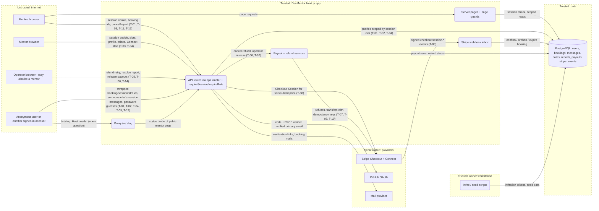

# Threat model: DevMentor

**Scope:** whole system — the Next.js app (`packages/app`) with its `core`, `db` and `ui` packages, plus the owner-run CLI scripts
**Last updated:** 2026-11-23
**Owner:** Łukasz Lasota (session owner)

DevMentor is a marketplace where mentees book and prepay 25/50-minute text sessions with invited mentors through Stripe Checkout; mentors are paid through Stripe Connect transfers that the operator (the two founders) releases from `/admin`. Three roles share one account model (`mentee`, `mentor`, `operator`; one person can be mentor and operator). The threats that matter most are (1) one account reading or acting on another account's booking, session or mentor data by swapping an id, and (2) money moving to the wrong place: a payout released for a session that was never delivered, or a dispute settled by an operator who is the mentor on that booking.

## 1. What are we working on?

### System profile

| Application | Type | Stack | Deployed as | Auth | Tenancy | AI |
| --- | --- | --- | --- | --- | --- | --- |
| `packages/app` (+ `core`, `db`, `ui` as libraries) | Browser web app + JSON API (`app/api/**/route.ts`) + Stripe webhook receiver | Next.js 16 App Router, React 19, MikroORM 7, PostgreSQL, Awilix, Zod 4 | Not stated in the repo (assumption: one Node process behind a reverse proxy) | `dm_session` cookie with a signed session token, checked live on every request (`packages/core/src/auth/session-user.ts:27-52`); GitHub OAuth with PKCE + signed state cookie, or email + password set from a mailed link | No tenants; isolation is per owner: `mentee` on bookings, mentor profile owned by user id, session parties = the booking's mentee or mentor | None |
| `scripts/invite.mts`, `scripts/seed.mts` | CLI, owner-run | tsx, same core services | Owner workstation | Owner shell with DB credentials from the local dotenv file | n/a | None |

Architecture: modular monolith; route files only wire `@devmentor/core/http` handlers (`apiHandler` → `requireSession` / `requireRole` → service).
Data stores: PostgreSQL (users, invitations, mentor profiles, slots, bookings, booking reports, session messages / answers / note versions, payouts, Connect accounts, raw Stripe events, rate-limit counters).
External systems: Stripe (Checkout, refunds, Connect Express accounts and transfers, webhooks), GitHub OAuth, mail provider (Resend, or log in development).
Isolation: no tenant column. Every owner check lives in the service query: `mentee: <session user>` for bookings, `mentorProfile.user = <session user>` for mentor data, `partyWhere` (mentee or mentor of a confirmed booking) for sessions. Roles are stored in `users.roles`; `operator` is derived on every request from a verified email listed in `OPERATOR_EMAILS` (`packages/core/src/services/auth/account.service.ts:99-109`).

### Assets (what we protect)

- Money: mentee card payments (Checkout), refunds, mentor payouts (Connect transfers), the platform fee.
- Private session content: chat messages, the written answer, session note versions and decline comments; dispute report messages.
- Personal data: emails, GitHub logins, booking history, raw Stripe event payloads (`stripe_events.payload`, includes the customer email).
- Accounts and roles: sessions, password hashes, the `mentor` role (invitation only), the `operator` role.
- Mentor inventory: published slots (a held slot cannot be sold to anyone else).
- Secrets: `SESSION_SECRET`, `STRIPE_SECRET_KEY`, `STRIPE_WEBHOOK_SECRET`, GitHub client secret, mail API key, database URL.

### Actors

| Actor | Access | Motivation |
| --- | --- | --- |
| Anonymous internet user | Public pages, `GET /api/mentors`, `GET /api/mentors/[slug]`, `GET /api/invitations/[token]`, auth routes, Stripe webhook URL | Account takeover, forged payment, slot blocking |
| Mentee A (signed in) | Own bookings and sessions | Read or cancel mentee B's booking, read B's session, get a refund that is not due |
| Mentor A (signed in) | Own page, prices, slots, Connect, sessions where A is the mentor | Edit mentor B's page or slots, read B's sessions, collect a payout without delivering |
| Party of a booking acting outside its role | Mentee or mentor of the same booking | Mentee writes the answer or a note; mentor approves its own note or cancels the mentee's booking |
| Operator (may also be a mentor) | `/admin`, refund retry, report resolution, payout release | Settle a dispute in their own favour; unattributed money actions |
| Anyone posting to the webhook (Stripe is semi-trusted) | `POST /api/webhooks/stripe`, no CSRF header | Forged or replayed `checkout.session.completed` |
| Compromised dependency or provider | Build or runtime | Read secrets, tamper with payments |

### Entry points

| Application | Entry point | Auth required | Notes |
| --- | --- | --- | --- |
| app | `POST /api/auth/register`, `/sign-in`, `/verify-email`, `/verify-email/resend`, `/sign-out`; `GET /api/auth/github`, `/github/callback`, `/me` | no (`/me`: session) | Rate limits per email; per IP only when `TRUSTED_PROXY_HOPS` > 0 |
| app | `GET /api/invitations/[token]`, `POST /api/invitations/[token]/accept` | lookup: no; accept: session + verified matching email | Token in path, `no-referrer`, the logger redacts it |
| app | `GET /api/mentors`, `GET /api/mentors/[slug]`, proxy on `/m/:slug` | no | Allowlisted public DTO |
| app | `GET/PUT /api/mentors/me`, `PUT /prices`, `POST /publish`, `/unpublish`, `/connect/start`, `/connect/refresh`; `GET/POST /api/availability/slots`, `DELETE /api/availability/slots/[id]` | session + `mentor` | Owner is always the session user |
| app | `POST /api/bookings`; `GET /api/bookings/[id]`; `POST /api/bookings/[id]/release`, `/cancel`, `/report` | session (any role) | Loads by `id` and `mentee` |
| app | `GET /api/sessions/[id]`; `POST /messages`, `/answer`; `GET/POST /note`; `POST /note/decision` | session, party of the booking | `partyWhere` |
| app | `POST /api/admin/bookings/[id]/refund`, `/api/admin/payouts/release`, `/api/admin/reports/[id]/resolve`; page `/admin` | session + `operator` | |
| app | `POST /api/webhooks/stripe` | Stripe signature, CSRF off | 512 KiB body cap |
| app | `GET /api/health` | no | DB up / down only |
| CLI | `npm run invite`, `npm run db:seed` | owner shell | Writes invitations and users directly |

### Data flow and trust boundaries

Boundaries: browser ↔ app (session cookie, CSRF header, ids in paths); app ↔ PostgreSQL; app ↔ Stripe (outbound API with the secret key, inbound signed webhooks); app ↔ GitHub and the mail provider; owner workstation ↔ DB (CLI).
Diagram source: `docs/security/threat-model.mmd`. Not rendered: `mmdc` is not installed. To render where a headless browser is acceptable: `npx @mermaid-js/mermaid-cli -i docs/security/threat-model.mmd -o docs/security/threat-model.svg`.

### AI components

| Component | Untrusted input | Sensitive data / systems | Changes state or sends externally | Rule of Two verdict |
| --- | --- | --- | --- | --- |
| None in the product (no LLM SDK under `packages/`) | — | — | — | Not applicable. Agent tooling is covered by `.ai/security-notes.md`. |

### Assumptions and open questions

- [ ] Where is production hosted, and what proxy sits in front? `TRUSTED_PROXY_HOPS` defaults to 0 (`packages/core/src/config/env.ts:112`, and 0 in the example env file), which skips every per-IP rate limit (`packages/core/src/security/rate-limit.ts:79-95`). What value does production set?
- [ ] Does the host reject unknown `Host` headers? The proxy builds its probe URL from `request.nextUrl.origin` (`packages/app/src/proxy.ts:20`); if that follows a client-supplied Host, the server sends a GET to a host the client chose (blind, status only).
- [ ] Should a payout wait for the mentor's written answer? `releaseDue` pays any confirmed booking that ended 24 h ago with no open report (`packages/core/src/services/payments/payout.service.ts:80-85, 122-124`); the payouts spec treats the closed answer window as enough.
- [x] May an operator resolve a report on a booking where they are the mentor? No: 403 since 2026-11-23 (T-06, decided by the session owner Łukasz Lasota while fixing it; recorded in `.ai/specs/implemented/2026-11-21-mentor-payouts.md`).
- [ ] Is a record of which operator did what required beyond the R16 shared note? No actor is stored for refund retry, report resolution or payout release (T-14).
- [ ] Which security headers (CSP, `frame-ancestors`, HSTS) does the hosting layer add? `packages/app/next.config.ts:25-36` sets only `Referrer-Policy` and `Cache-Control` for two paths.
- [ ] How long are raw Stripe event payloads kept in `stripe_events`? No retention rule found.
- [ ] Assumed, not verified: production secrets come from the host's secret store and are never committed (dotenv files were not opened for this model).

## 2. What can go wrong?

L = likelihood, I = impact (H / M / L). Paths below are relative to `packages/core/src/` unless they start with `packages/`.

| ID | Threat | STRIDE | Where | L | I | Response | Control today | How we verify | OWASP / CWE |
| --- | --- | --- | --- | --- | --- | --- | --- | --- | --- |
| T-01 | Mentee A reads, releases, cancels (refund mail, slot reopened) or reports mentee B's booking by swapping the id in `/api/bookings/{id}` | I, T, E | `http/bookings.ts:42-92`; `services/bookings/booking.service.ts:183, 215`; `services/bookings/booking-cancellation.service.ts:78`; `services/bookings/booking-report.service.ts:53` | M | H | Mitigate: keep every booking query keyed by `id` **and** `mentee`; 404 for anyone else | Present: all four queries filter by `mentee: menteeId`. Unit tests (`booking.service.test.ts:717`, `booking-cancellation.service.test.ts:192`, `booking-report.service.test.ts:144`); integration only for `/report` (`packages/app/integration/booking-cancellation.test.ts:202`) | Integration, two mentees: B's cookie on A's booking for GET, `/release`, `/cancel` → 404 and A's booking unchanged | A01:2025, API1:2023, CWE-639 |
| T-02 | A non-party (mentee B, mentor B, an operator) reads or writes the messages, written answer or note of the session between mentee A and mentor A via `/api/sessions/{id}/**` | I, T | `services/sessions/session.service.ts:69-75, 221-229`; `services/sessions/session-note.service.ts:226-230` | M | H | Mitigate: one access rule `partyWhere` (confirmed booking, caller is its mentee or mentor) on every read and write | Present. Integration covers a stranger **mentee** only (`packages/app/integration/text-session.test.ts:132-133`, `packages/app/integration/session-note.test.ts:127`); mentor B and operator untested | Integration with mentor B and an operator on GET session, POST messages, GET note → 404 | A01:2025, API1:2023, CWE-639 |
| T-03 | A party acts outside its role on its own booking: mentee submits the answer or a note version; mentor approves its own note; mentor reads or cancels the mentee's booking | E, T | `services/sessions/session.service.ts:158-160`; `services/sessions/session-note.service.ts:114-115, 174-175`; booking queries keyed by mentee (T-01) | M | M | Mitigate: role-of-party checks in the services | Present (unit `session.service.test.ts:266`, `session-note.service.test.ts:187`) | Integration, mentee A / mentor A on one booking: mentee on `/answer`, `POST /note` → 403; mentor on `/note/decision` → 403, on `/api/bookings/{id}` and `/cancel` → 404 | A01:2025, API5:2023, CWE-863 |
| T-04 | Mentor A changes mentor B's slots, page, prices or Connect onboarding (deletes B's slot by id; points B's payouts elsewhere) | T, E | `http/availability.ts:34-37`; `services/availability/slot.service.ts:179-182, 283-291`; `http/mentors.ts:28-73`; `services/payments/connect.service.ts:142-143` | L | H | Mitigate: no client-supplied owner id; every query by the session user's profile | Present: owner routes take no owner id; slot removal filters by `mentorProfile: profile.id` | Integration, mentors A and B: A on `DELETE /api/availability/slots/{B's slot}` → 404, B's slot still listed; A's `/connect/start` leaves B's Connect row untouched | A01:2025, API1:2023, CWE-639 |
| T-05 | Mentee or mentor without `operator` reaches refund retry, report resolution or payout release; a mentee reaches mentor routes; an unverified allowlisted email gets `operator` | E | `http/bookings.ts:76-77`; `http/payouts.ts:29, 39`; `http/mentors.ts:28-33`; `services/auth/account.service.ts:105`; `auth/session-user.ts:52` | L | H | Mitigate: `requireRole` in every handler; operator only from a **verified** email in `OPERATOR_EMAILS`, reconciled per request | Present. Integration: only refund retry → 403 for a mentee (`packages/app/integration/booking-cancellation.test.ts:183`) | Integration: mentee and mentor-only cookies on all three `/api/admin/**` routes → 403; mentee on `/api/mentors/me/**` → 403; unverified allowlisted account has no `operator` | A01:2025, API5:2023, CWE-862 |
| T-06 | A mentor who is also an operator resolves the mentee's dispute report on **their own** booking, then releases their own payout | E, R | `http/payouts.ts:38-46`; `services/bookings/booking-report.service.ts:117-125`; `services/payments/payout.service.ts:122-124` | L | H | Mitigate: refuse resolution (and release of that booking) when the operator owns the booking's mentor profile, or require the other founder; store `resolvedBy` | Present since 2026-11-23: `BookingReportService.resolve` refuses (403) an operator who owns the booking's mentor page; `resolvedBy` not stored yet (T-14) | Unit + integration (`report-own-booking-resolve.test.ts`, TC-PAYOUT-002): account with mentor+operator resolves a report on its own booking → 403, and the same account resolves another mentor's report → 200 | A01:2025, A06:2025, CWE-284 |
| T-07 | Payout released for a session the mentor never delivered (no messages, no written answer) because the mentee did not report within 24 h; a transfer is not reversed later | T | `services/payments/payout.service.ts:80-85, 122-124` | M | H | Mitigate: hold a payout without a `SessionAnswer`, or list it for an explicit operator decision | Partial: only an open report holds a payout | Unit: confirmed booking past 24 h without an answer is held; integration on `/api/admin/payouts/release` | A06:2025, API6:2023, CWE-840 |
| T-08 | Forged, replayed or mismatched payment confirmation confirms a booking not paid at the held price | S, T | `http/stripe-webhook.ts:5-8`; `services/payments/webhook-signature.ts:59, 67`; `services/payments/stripe-inbox.service.ts:59, 127`; `services/bookings/booking.service.ts:279-287, 421` | L | H | Mitigate: HMAC over the raw bytes with 300 s tolerance, event-id dedupe, price from the server, amount + currency checked against the hold | Present. Gap: the event's session id is not compared with the stored `checkoutSessionId` (`booking.service.ts:287` only fills it when empty) | Existing `packages/app/integration/stripe-webhook.test.ts`; add a unit test: completion whose session id differs from the stored one → orphaned, not confirmed | A08:2025, API10:2023, CWE-345 |
| T-09 | A refund is paid twice or one that is not due is paid (repeat cancel, cancel racing the 24 h line, operator retry racing the mentee) | T | `services/bookings/booking-cancellation.service.ts:93-105, 125-150, 179-198`; `services/payments/stripe-checkout-gateway.ts:146` | L | M | Mitigate: one idempotency key per booking, conditional status updates, server-side terms check against `expectRefund` | Present | Unit tests exist; integration: parallel `/cancel` on one booking → one refund in Stripe test mode / stub | A06:2025, CWE-362 |
| T-10 | A payout is transferred twice, or to a connected account other than the booking's mentor | T | `services/payments/payout.service.ts:150-187`; `services/payments/stripe-connect-gateway.ts:96` | L | H | Mitigate: claim under row lock, look up the transfer before creating it, idempotency key per booking and attempt, destination from the booking's own profile | Present | Integration (`packages/app/integration/mentor-payouts.test.ts`): two parallel releases → one transfer; destination = the booking mentor's account | A06:2025, CWE-362 |
| T-11 | Throwaway accounts hold all of a mentor's slots (each hold lasts about 36 min) so real mentees see "taken" | D | `http/bookings.ts:28`; `services/bookings/booking.service.ts:18-20`; `security/rate-limit.ts:79-95` | M | M | Mitigate: per-IP limits in production (set `TRUSTED_PROXY_HOPS`), cap concurrent holds per mentor | Partial: one hold per mentee, booking-start limit per email only; no per-IP limit by default | Manual, two accounts: second account cannot book the held time; re-check limits with the production proxy setting | API6:2023, API4:2023, CWE-770 |
| T-12 | Password spraying or credential stuffing across many emails, operator accounts included | S | `services/auth/account.service.ts:320-339`; `security/rate-limit.ts:79-95`; `config/env.ts:112` | M | H | Mitigate: set `TRUSTED_PROXY_HOPS` in production and refuse to boot in production when it is 0; consider GitHub-only sign-in for operators | Partial: per-email limits and uniform failures; per-IP limits skipped without a client IP | Production config review; `packages/app/integration/rate-limit.test.ts` run with hops > 0 | A07:2025, API2:2023, CWE-307 |
| T-13 | Cross-site actions on a signed-in user: CSRF on state-changing routes, clickjacking of Book / Cancel, injected script | T, E | `http/apiHandler.ts:86-90`; `http/envelope.ts:24-25`; `http/cookies.ts:11-14`; `packages/app/next.config.ts:25-36` | L | M | Mitigate: keep the custom-header CSRF check and the SameSite=Lax HttpOnly cookie; add CSP with `frame-ancestors 'none'` and HSTS | Partial: CSRF header and cookie flags present; no CSP or framing protection in the app | DAST: state-changing POST without the header → 403; check CSP / `frame-ancestors` on `/bookings/*`, `/admin` | A01:2025, A02:2025, CWE-352, CWE-1021 |
| T-14 | Operator money actions cannot be attributed: who retried a refund, resolved a report or released payouts | R | `http/bookings.ts:75-79`; `http/payouts.ts:28-46`; `services/bookings/booking-report.service.ts:125` | M | M | Mitigate: store the operator id on report resolution and payout runs; log actor + target | None: handlers drop the session user after the role check | Log review after an integration run: each admin action carries the operator id | A09:2025, CWE-778 |

STRIDE notes for letters without their own row. Spoofing: sessions are live-checked and revoked by `session_version` (`auth/session-user.ts:43`); GitHub links only a verified primary email (`services/auth/github-oauth.service.ts:154`); an invitation binds to the verified invited email (`services/invitations/invitation.service.ts:310`). Information disclosure on public endpoints is limited to the allowlisted `MentorPublicView` (`services/mentors/mentor-profile.service.ts:50-63`); the invitation lookup shows the invited email to the token holder by design (`services/invitations/invitation.service.ts:263`). Denial of service in chat is bounded at 500 messages per session (`services/sessions/session.service.ts:13, 144`), with no rate limit (spec Q8).

## 3. Test scope

| Method | What to try | Threats |
| --- | --- | --- |
| Integration tests | Two mentees: B's cookie on A's `GET /api/bookings/{id}`, `/release`, `/cancel` → 404, A's booking unchanged | T-01 |
| Integration tests | Mentor B and an operator on A's `GET /api/sessions/{id}`, `POST /messages`, `GET /note` → 404 | T-02 |
| Integration tests | One booking: mentee on `/answer`, `POST /note` → 403; mentor on `/note/decision` → 403, on `/api/bookings/{id}` and `/cancel` → 404 | T-03 |
| Integration tests | Mentors A and B: A on `DELETE /api/availability/slots/{B's slot}` → 404, B's slot intact | T-04 |
| Integration tests | Mentee and mentor-only cookies on `/api/admin/**` → 403; unverified allowlisted email has no operator role | T-05 |
| Unit + integration | Mentor+operator resolves a report on own booking → refused; payout held without a written answer; mismatched session id → orphaned | T-06, T-07, T-08 |
| Integration tests | Parallel cancels → one refund; parallel releases → one transfer to the booking mentor's account | T-09, T-10 |
| Config review | Production `TRUSTED_PROXY_HOPS`, Host validation, security headers, secret injection | T-11, T-12, T-13 |
| DAST (no session, then mentee A's session) | Webhook without / with a stale signature → 400; state-changing POST without the CSRF header → 403; response headers on `/`, `/bookings/*`, `/admin` | T-08, T-13 |
| Manual, two accounts | Second mentee tries the time a first mentee holds; the hold expiry reopens it | T-11 |
| Log review | Admin actions carry operator id and target | T-14 |
| Prompt injection | Not applicable (no AI component) | — |

**Out of scope:** Stripe, GitHub and mail-provider infrastructure; volumetric DoS; social engineering of the founders; production and any shared environment; the agent workshop (covered by `.ai/security-notes.md`).

**Rules of engagement:** local or isolated test environment only (testcontainers Postgres, Stripe test mode or the repository's Stripe stub); synthetic data only, seeded with at least two mentees, two mentors and one account that is both mentor and operator; no real card data, no real customer data, no production secrets.

## 4. Did we do a good job?

- [x] Every application in scope has a row in the System profile
- [x] Every entry point and every boundary crossing on the diagram was walked through all six STRIDE letters
- [x] Every AI component has a Rule of Two verdict (none exist)
- [x] Every High threat has a mitigation and a verification
- [x] Cross-role (T-03, T-05, T-06) and same-role cross-account (T-01, T-02, T-04) threats are present; multi-tenancy is not applicable
- [x] Threat IDs are annotated on the diagram's flows
- [x] Assumptions are marked, not presented as facts
- [x] The document contains no attack instructions, payloads or exploit code
- [x] Out of scope and rules of engagement are written down

## Changelog

- 2026-11-23 Initial model (branch `feat/lesson-16-security`)
- 2026-11-23 T-06 confirmed on the test env (operator-mentor resolved its own dispute: HTTP 200) and fixed: 403, report stays open. T-01 and T-02 checked with two accounts, no breach (`.ai/context/2026-11-23-lesson-16-security.md`).
- 2026-11-23 Fix plan for the remaining High / None / Partial threats: `docs/security/fix-plan.md` (some "Control today" cells understate existing integration coverage; the plan has the current state).
